# OOS: an open operating system for the Rigol DHO800/DHO900

OOS replaces the software of a Rigol DHO800/DHO900 oscilloscope with a Linux 6.12 kernel and a new scope application
written in Rust. It runs from the scope's own SD card, next to the stock system, and you can switch back at any time.

> **Experimental software. Read the [disclaimer](#disclaimer) before you install it.**
> OOS has run on a DHO924S and, by a user report, on a DHO804; several functions have never run on real hardware
> ([status](#status)). Measurements made with OOS are not calibrated to any standard.

<table>
<tr><td>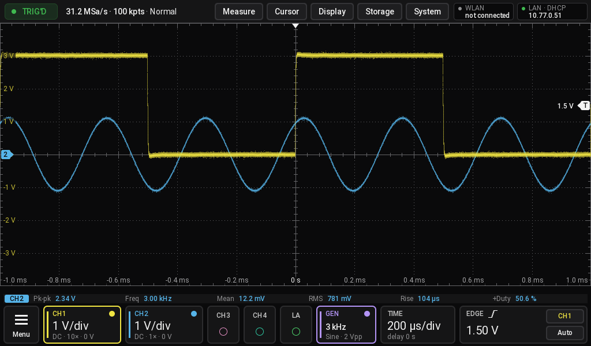</td>
<td>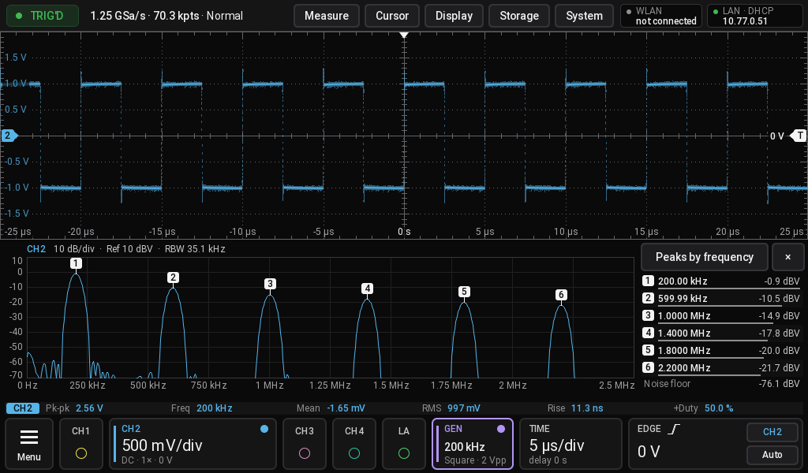</td></tr>
<tr><td>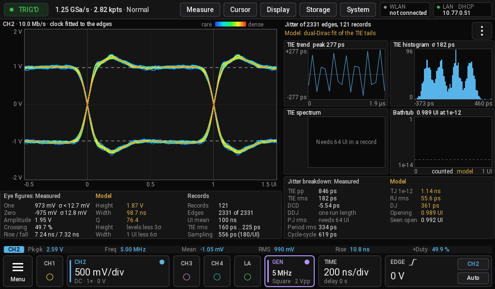</td>
<td>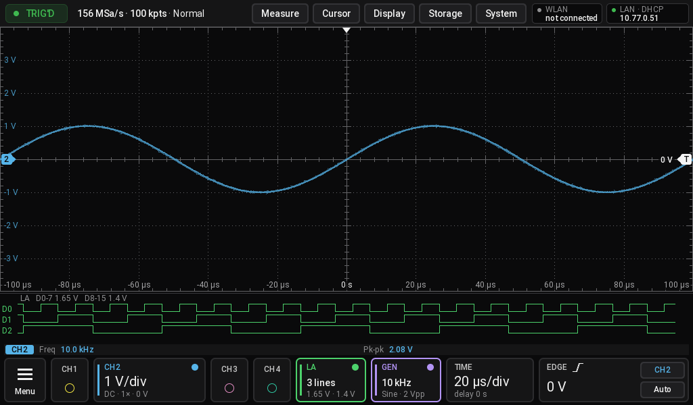</td></tr>
</table>

All pictures are screenshots of a DHO924S running OOS. More in the [gallery](#gallery). How to install and use it is in
the [wiki](https://github.com/dekajoule/oos/wiki): [start here](#getting-started).

## Thanks

OOS builds on the work of these projects. Thank you to everyone behind them:

- **[NovaOS](https://github.com/Bradyok/novaos-kernel-source)** by Olympian LED, Inc., for publishing the GPL source of
  its Linux port to this hardware, which showed what a kernel needs here and where OOS started. The patches, device tree
  and configuration of the OOS kernel are written anew today. Its install notes also helped with the loader's image format.
- **[Norbert Kiszka](https://github.com/norbertkiszka)**, for the findings about this hardware he shared in public.
- **[Linux](https://kernel.org)**, the kernel underneath everything, and **[Rockchip](https://github.com/rockchip-linux/kernel)**
  for the board support it runs on here.
- **[Xilinx XDMA driver](https://github.com/Xilinx/dma_ip_drivers)**, which connects the SoC to the FPGA over PCIe.
- **[BusyBox](https://busybox.net)**, the userland of the image.
- **[e2fsprogs](https://e2fsprogs.sourceforge.net)** by Theodore Ts'o, which checks the data partition at every start.
- **[wpa_supplicant](https://w1.fi/wpa_supplicant/)** by Jouni Malinen and contributors, for WLAN.
- **[linux-firmware](https://git.kernel.org/pub/scm/linux/kernel/git/firmware/linux-firmware.git)** and Realtek, for the
  firmware of the WLAN stick.
- **[Rust](https://www.rust-lang.org)** and the **[libc](https://github.com/rust-lang/libc)** crate, the only dependency
  of the OOS code on the scope.
- **[Roboto](https://github.com/googlefonts/roboto-classic)**, the typeface of the screen.

Sources and licences of the kernel parts are listed in [kernel/README.md](kernel/README.md).

## Contents

- [Disclaimer](#disclaimer)
- [How OOS is made](#how-oos-is-made)
- [Supported models](#supported-models)
- [What OOS does](#what-oos-does)
- [Gallery](#gallery)
- [Status](#status)
- [Getting started](#getting-started)
- [Repository layout](#repository-layout)
- [Development](#development)
- [Licences](#licences)

## Disclaimer

**Use OOS entirely at your own risk.** OOS is provided "as is", without warranty of any kind, express or implied,
including but not limited to merchantability, fitness for a particular purpose and non-infringement. To the maximum
extent permitted by applicable law, the authors and contributors are not liable for any damage or loss arising from
its use or from following these instructions. That includes damage to the instrument, to connected equipment or
devices under test, loss of data or calibration, lost warranty, wrong measurements, injury and any consequential loss.

Installing OOS means that you accept in particular the following risks:

- **Warranty.** The boot card is inside the instrument. **Installing OOS with a second card means opening the scope,
  and that voids the warranty.** The USB install does not open it, but it changes the card, and nothing here promises
  that your warranty survives that. If it goes wrong, you may have to open the scope anyway.
- **Instrument damage.** OOS drives the hardware directly: FPGA, ADC, front ends, sample clock, fan, relays and the
  generator output. A software fault can leave hardware in a state the stock firmware would never select. A failed fan
  control or a wrong setting can cause overheating or damage.
- **Data loss.** A mistake while writing the card can make the scope unbootable or destroy the factory calibration
  stored on it. Without a good copy of your original card this data **cannot be replaced**.
- **Licences.** Option licences of the stock system have been seen to stop working after running OOS, and had to be
  entered again. Keep your licence keys at hand.
- **Wrong measurements.** OOS is not a calibrated or certified measuring instrument. Readings, trigger behaviour,
  decoders and analysis results can be wrong without any visible sign. Do not use OOS for safety-relevant, medical,
  legal, commercial or compliance measurements, and never rely on it to decide whether something is safe to touch.
- **Electrical safety.** OOS changes nothing about the input ratings of the instrument. Observe the manufacturer's
  safety instructions and ratings. The open instrument contains a mains power supply with dangerous voltages. Disconnect
  the mains and all probes before you open it, and close it again before you connect mains. Only open it if you know
  how to do this safely.
- **Network security.** Apart from SSH (password or key, [docs/network.md](docs/network.md) 7) OOS has no
  authentication: telnet (on by default, a shell without password), SCPI, VXI-11, HiSLIP (on a computer), the web remote and MCP are open to everyone who can reach the scope. The community signing key is public, so anyone on the
  network can also install an update. This holds for WLAN as well. **Connect the scope to a trusted bench network only,
  never directly to the internet.**
- **Experimental settings.** System > Overclock (with `adc.overclock = on`) and `/oos/limits.conf` can change the sample
  clock, `limits.conf` can also lift limits. Values outside the defaults are outside any rating and can make the scope
  unusable or damage it.
  Overclocked records lose samples at the full rate, so they are wrong: see [docs/models.md](docs/models.md).

OOS is an independent project. It is not affiliated with, endorsed by or supported by RIGOL TECHNOLOGIES CO., LTD.
Rigol and all other names are trademarks of their respective owners and are used here only to identify the hardware.
Do not contact Rigol for support with OOS. The repository contains no Rigol code ([how OOS is made](#how-oos-is-made)).
At run time OOS uses the FPGA image already in the scope's flash, the calibration files on its own card and the stock
software on that card, which it needs to read the scope's identity. It only reads them.

## How OOS is made

OOS is an **independent reimplementation**. The tree holds only descriptions of the scope's behaviour in our own
words, and code written to them. The descriptions in [docs/](docs/README.md) are **black-box**: they say what goes in
and what comes out at the scope's interfaces, that is the values its registers take and return, the words on the buses
to the front ends, ADC, PLL and panel as they appear on a running unit, the signals at its inputs and outputs, the
answers of the stock SCPI, and what Rigol publishes for users (the programming guide, the manuals) together with the
data sheets of the parts. Each fact says how it is known (verified on the unit, assumed, or not yet verified on
hardware). The tree holds no vendor code or data, and since
[ADR 0026](docs/adr/process/0026-contributions-are-signed-off-and-hold-no-vendor-material.md) (2026-11-16) the same
rule holds for every text around the code: commit messages, pull requests and issues.

The decision records say this in detail:
[ADR 0030](docs/adr/process/0030-independent-reimplementation-from-black-box-descriptions.md) (this rule),
[ADR 0013](docs/adr/process/0013-no-vendor-code-only-libc.md) (no vendor code or data),
[ADR 0015](docs/adr/process/0015-say-how-you-know.md) (how a fact is known) and
[ADR 0026](docs/adr/process/0026-contributions-are-signed-off-and-hold-no-vendor-material.md) (contributions).

## Supported models

OOS reads the model from `/rigol/data/vendor.bin` at start and adapts channels, logic analyser, generator and EXT
trigger to it. The stock software has to be on the card for that; without it, set `model = ...` in `/oos/limits.conf`.
Details and limits: [docs/models.md](docs/models.md).

| Model | Rated bandwidth | Channels | Logic analyser | Generator | EXT trigger | Runs OOS |
|---|---|---|---|---|---|---|
| DHO802 / DHO812 | 70 / 100 MHz | 2 | - | - | yes | not yet |
| DHO804 / DHO814 / DHO824 | 70 / 100 / 250 MHz | 4 | - | - | - | a DHO804 runs it (user report) |
| DHO914 / DHO924 | 125 / 250 MHz | 4 | yes | - | - | not yet |
| DHO914-EDU / DHO924-EDU | 125 / 250 MHz | 4 | yes | - | - | not yet |
| DHO914S / DHO924S | 125 / 250 MHz | 4 | yes | yes | - | a DHO924S runs it (developer's unit) |

Each row is one hardware variant: its models differ only in the licensed bandwidth ([docs/models.md](docs/models.md)
2.1), so a model whose row runs OOS counts as verified, and the USB install takes it without being told
([docs/install-usb.md](docs/install-usb.md) 4). The other models are prepared from the known model table and have
never run OOS. The feature columns follow the model line-up; whether the EDU variants have the LA port is not
confirmed. DHO1000,
HDO1000/2000/4000 and MHO models are different boards and are not supported; [docs/porting.md](docs/porting.md) says
what would carry over and how an owner can describe one.

Limits on all models:

| | 1 channel | 2 channels | 3-4 channels |
|---|---|---|---|
| Sample rate per channel | 1.25 GSa/s | 625 MSa/s | 312.5 MSa/s |
| Memory depth per channel | 125 M | 62.5 M | 31.25 M |
| Memory depth with the LA on | 31.25 M | 12.5 M | 10 M |

For how the hardware works, see the [hardware overview](https://dekajoule.github.io/oos/hardware/overview.html).

## What OOS does

- **Acquisition** up to 1.25 GSa/s and 125 M points: normal, peak detect, average and high resolution, roll and scan
  mode, zoom, Auto with four views of the signal
- **Trigger**: twelve hardware trigger types, protocol trigger on decoded bus events, zone trigger, noise reject
- **Display**: waveform windows, up to four views to switch between, full screen, three text sizes, HDMI output, the
  picture drawn on the GPU
- **Measurement and maths**: 35 automatic measurements with statistics, cursors, DVM, a frequency counter in the FPGA,
  a second pane (spectrum, results, events, trends), data logger, 8 math channels with free formulas, references,
  mask test
- **29 protocol decoders**, from UART, I2C and SPI to CAN-FD, MIL-STD-1553 and NMRA DCC
- **Analysers**: spectrum, eye diagram and jitter, power, Bode with the built-in or an external generator, bandwidth
  test, Identify
- **Logic analyser** with the PLA2216 probe, and the **generator** of S models
- **Remote control**: web remote, SCPI, VXI-11, MCP for AI assistants, SSH, the scope by name over mDNS
- **System**: its own cold boot of all hardware, self-calibration into its own files, signed updates with trial start
  and automatic rollback

Every feature in detail: [Features](https://github.com/dekajoule/oos/wiki/Features).

## Gallery

| | |
|---|---|
| 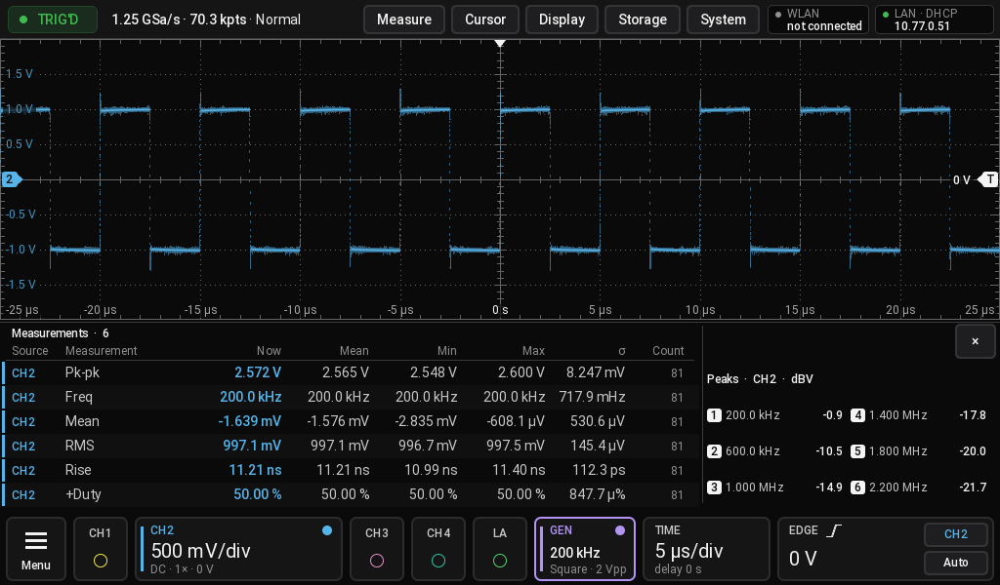 | 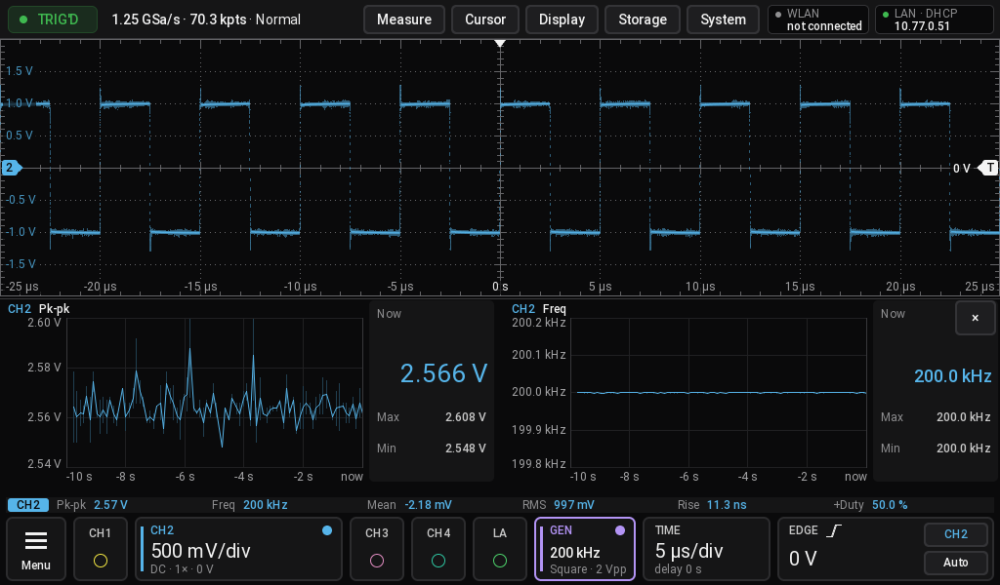 |
| Results pane: every measurement with statistics, peaks beside it | Trend pane: two measurements over time |
| 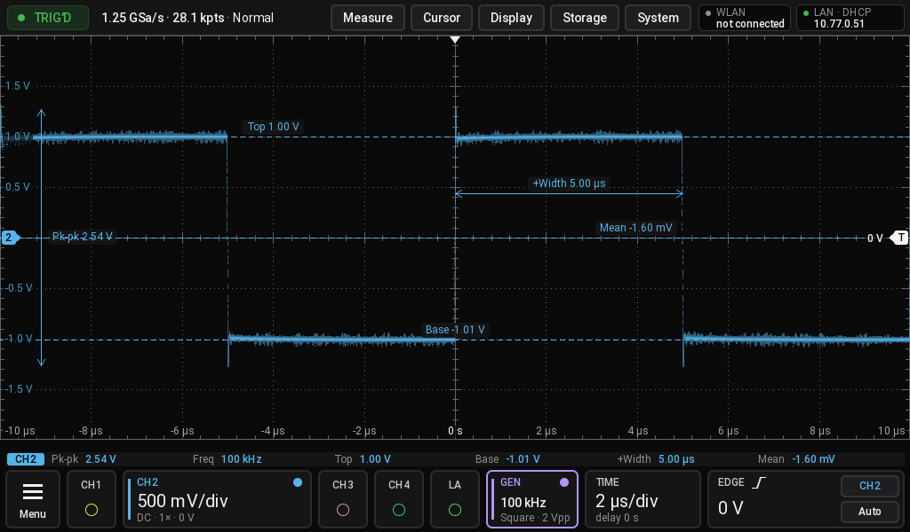 | 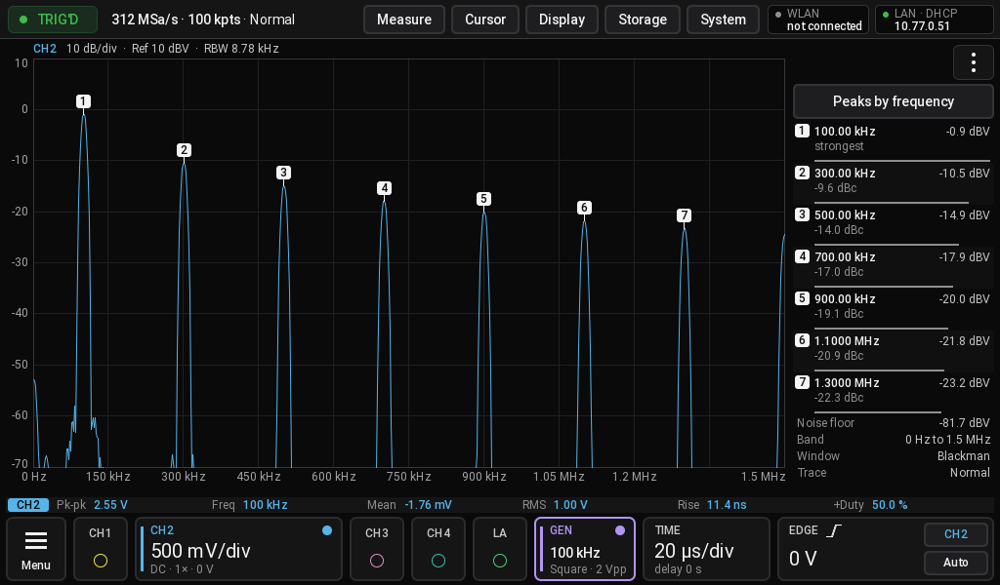 |
| Measurements labelled on the trace | Spectrum view with its peak list |
| 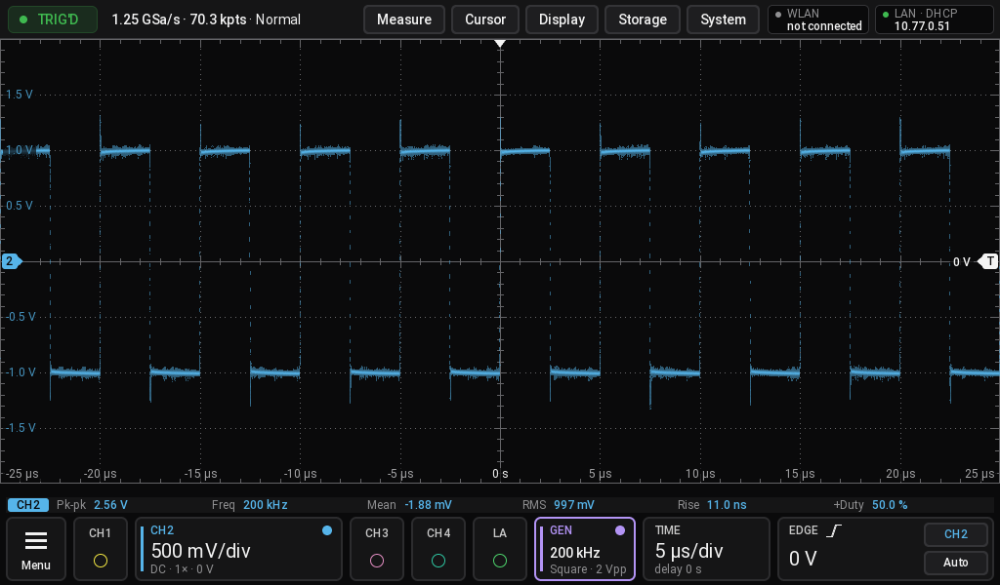 | 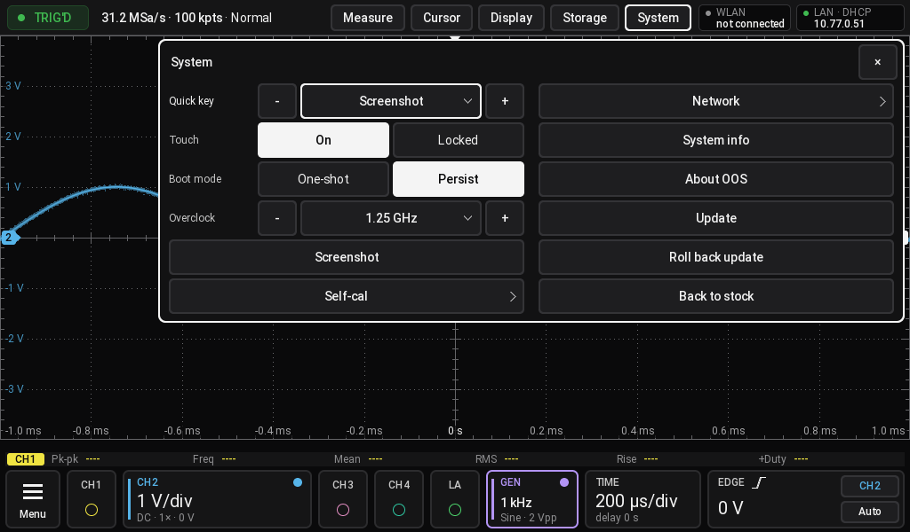 |
| The main screen, 200 kHz from the built-in generator | System menu |
| 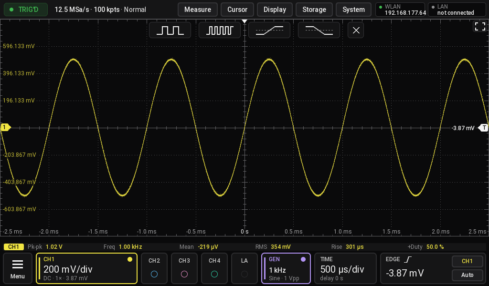 | 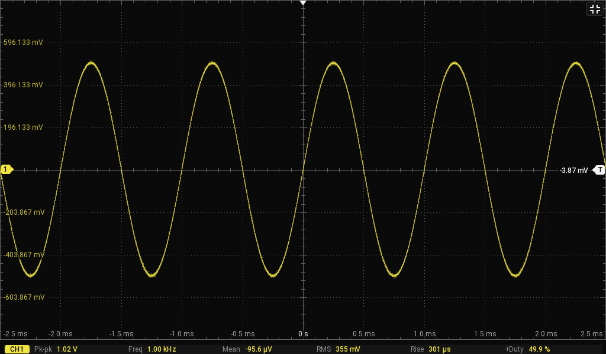 |
| After Auto: a few periods, many periods, rising or falling edge | Full screen, the same button goes back |

## Status

| Area | State |
|---|---|
| Boot, cold boot, acquisition, trigger, roll and scan, touch, front panel, generator (sine, built-in Bode), self-calibration | run on a DHO924S |
| Signed updates from the web page and the shell, kexec trial start, trial and confirmation, install over ADB | run on a DHO924S |
| An update with another device tree, tried by kexec first (kexec-tools, from 0.1.7) | run on a DHO924S: 0.1.6 to 0.1.7 to 0.1.8 through the web page, with cold starts |
| System > Graphics = GPU, JPEG live picture from the video encoder | run on a DHO924S, on the panel and with a 1920x1080 monitor in Mirror, Waveform and Layout |
| Frequency counter in the FPGA, backlight, AC/DC by a long press | run on a DHO924S (the counter with the built-in generator, 1.5 Hz to 9.9 MHz) |
| Logic analyser with a PLA2216: lines, pulse widths, edge, pulse, pattern, duration and protocol trigger, UART, SPI and I2C on the lines, roll, scan, whole deep records, CSV | run on a DHO924S, three lines (D0 to D2) driven; thresholds have no effect here, under stock neither |
| Generator modulation (AM, FM, PM), deep memory, limits, web, MCP, VXI-11 | run on a DHO924S |
| HDMI output | run on a DHO924S |
| Automatic rollback of a bad update | tests on the host only |
| USB install without opening the scope | run on a DHO924S with a modified stock system: dry run, first install, run again |
| Generator noise, system info, bandwidth test | tests on the host only |
| Bode with a free-running sweep | tests on the host only (synthetic sweeps); the scan path for sweeps above about 0.9 s is not yet tried on a unit |
| Bode with a generator on USB (USBTMC), UNI-T UTG900 preset | tests on the host only (a simulated USBTMC device); no generator on USB tried yet |
| USB storage stick, 10:1 probe | run on a DHO924S |
| WLAN | driver, firmware and scan run on a DHO924S with an RTL8188EU stick; joining a network tested on simulated radios only |
| Overclocking (System > Overclock) | run on a DHO924S: every step boots, but above 1.25 GHz records at the full rate lose samples; the default stays 1.25 GHz |
| Spectrum, eye and jitter, results and trend panes, measurement labels, Auto | run on a DHO924S with the generator and an RF source |
| Protocol decoders | tested with simulated signals; only some with real signals |
| All models other than the DHO924S | never run |
| Hardware averaging, 800 ps/div | not implemented |

The technical documents in [docs/](docs/README.md) say for each topic whether it is verified on the unit.

Known limits:

- Generator DC level: the output's middle jumps by about 85 mV where the generator switches its range at 2 Vpp.
  Whether the stock system shows the same is not known yet.
- High resolution only gains where the record has more samples than the screen has points.
- Logic analyser: D3 to D15 were not driven with a signal yet.
- WLAN: joining a network has not been tried on the unit.

## Getting started

The guides are in the [wiki](https://github.com/dekajoule/oos/wiki):

| Guide | What it covers |
|---|---|
| [Installation](https://github.com/dekajoule/oos/wiki/Installation) | from a USB stick without opening the scope, on a second card, or over ADB; the files of a release; how OOS starts |
| [First Steps](https://github.com/dekajoule/oos/wiki/First-Steps) | the first start, the screen, Auto, windows and views, text size, saving, date and time, self-calibration |
| [Measurements and Analysers](https://github.com/dekajoule/oos/wiki/Measurements-and-Analysers) | measurements, counter, panes, spectrum, eye, Bode, overclocking |
| [Generator](https://github.com/dekajoule/oos/wiki/Generator), [Logic Analyser](https://github.com/dekajoule/oos/wiki/Logic-Analyser) | the built-in generator of S models, the PLA2216 probe |
| [Remote Control](https://github.com/dekajoule/oos/wiki/Remote-Control), [SCPI and VXI-11](https://github.com/dekajoule/oos/wiki/SCPI-and-VXI-11) | web remote, network, WLAN, every remote interface and command |
| [Updates and Going Back](https://github.com/dekajoule/oos/wiki/Updates-and-Going-Back) | new versions, rollback, returning to stock |
| [Troubleshooting](https://github.com/dekajoule/oos/wiki/Troubleshooting) | what to do when something goes wrong |
| [Building](https://github.com/dekajoule/oos/wiki/Building) | building the image on macOS or Linux, trying OOS on a computer without a scope |

In one-shot mode, the default after an install, the next power-on starts the stock system again. OOS never writes the
FPGA flash, `/rigol/data`, or the `uboot`, `trust` and `parameter` partitions.

## Repository layout

The folders of the tree and what each holds: [AGENTS.md](AGENTS.md), Layout of the tree. Besides them: `keys/` (the
public keys trusted for updates and the community signing key), [CHANGELOG.md](CHANGELOG.md) (what changed between
releases), [docs/README.md](docs/README.md) (the index of the technical documentation) and
[tools/README.md](tools/README.md) (the host tools, and which of them touch a scope).

## Development

[CONTRIBUTING.md](CONTRIBUTING.md) says how to build, check and test a change, and how it gets into main. Coding
agents, and people new to the tree, start with [AGENTS.md](AGENTS.md); the hardware with the
[hardware overview](https://dekajoule.github.io/oos/hardware/overview.html) and
[docs/architecture.md](docs/architecture.md).

## Licences

OOS is free software under the GNU General Public License, version 2 or (at your option) any later version. See
[LICENSE](LICENSE).

Third-party parts keep their own licences. [THIRD-PARTY-LICENSES.md](THIRD-PARTY-LICENSES.md) lists every one of
them with its version, its licence, where its licence text is and which source files go with a release: the Linux
kernel and the XDMA driver, BusyBox, glibc and GCC's runtime, Mesa, libdrm and zlib (the GPU helper,
[gpu/README.md](gpu/README.md)), e2fsck, kexec, wpa_supplicant with libnl, nftables with libmnl and libnftnl, Dropbear,
OpenSSH's `sftp-server`, musl, the Rust standard library, the Roboto font, the wireless regulatory database and the
RTL8188EU firmware. An image built from this tree carries the licence texts and that list under `/etc/licenses`.

Every release carries the source archives of the binaries in its image next to the image. If you pass on an OOS
image, the GPL requires you to provide the corresponding source as well: pass those archives and this tree at the
release's tag on with it, or point to the release.
