# OOS: an open operating system for the Rigol DHO800/DHO900

OOS replaces the software of a Rigol DHO800/DHO900 oscilloscope with a Linux 6.12 kernel and a new scope application
written in Rust. It runs from the scope's own SD card, next to the stock system, and you can switch back at any time.

> **Experimental software. Read the [disclaimer](#disclaimer) before you install it.**
> OOS has run on a DHO924S and, by a user report, on a DHO804; several functions have never run on real hardware
> ([status](#status)). Measurements made with OOS are not calibrated to any standard.

<table>
<tr><td>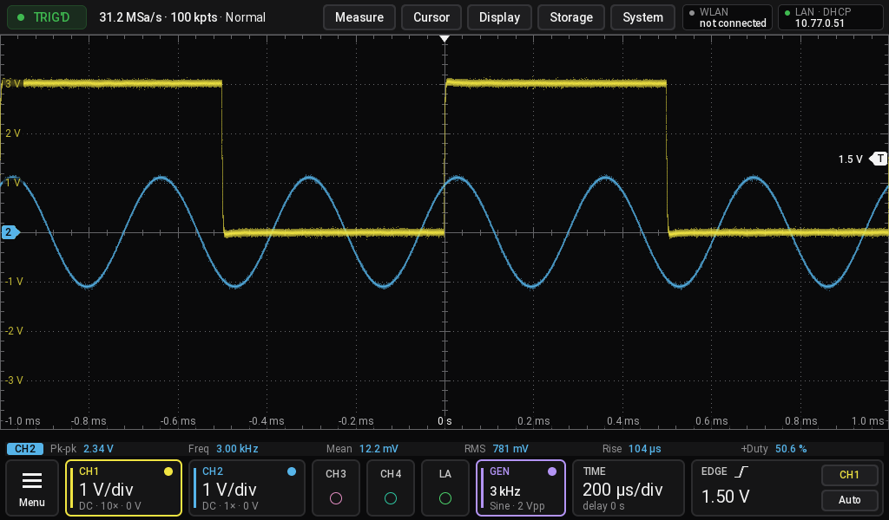</td>
<td>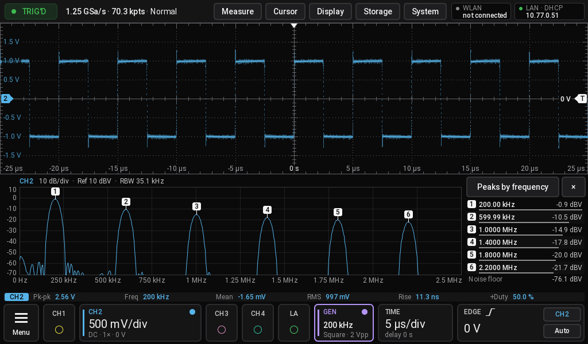</td></tr>
<tr><td>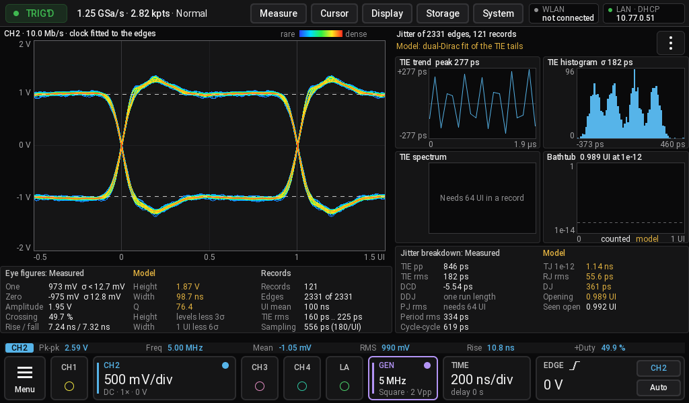</td>
<td>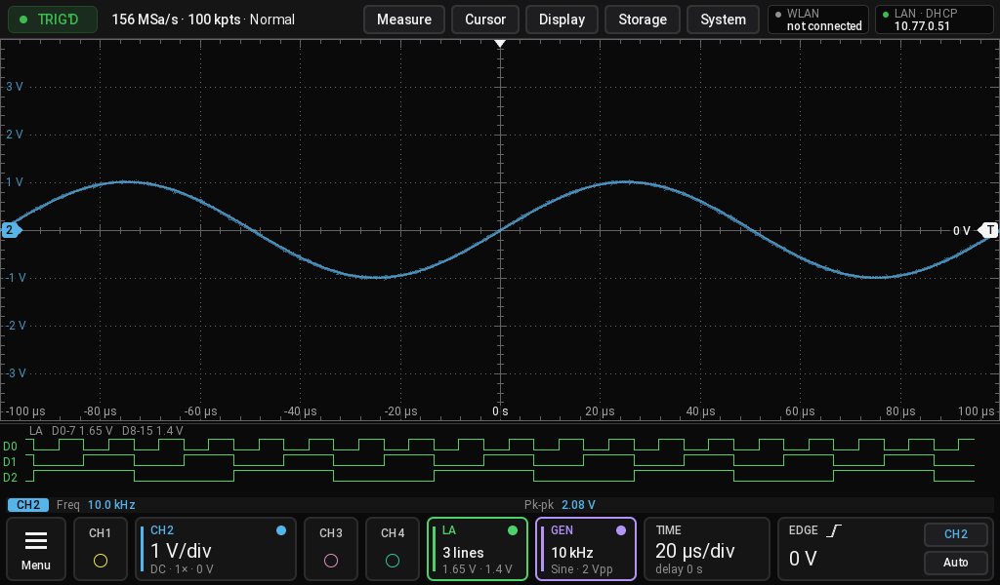</td></tr>
</table>

All pictures are screenshots of a DHO924S running OOS. More in the [gallery](#gallery). Guides are in the [wiki](https://github.com/deckerjulian/oos/wiki).

## Thanks

OOS builds on the work of these projects. Thank you to everyone behind them:

- **[NovaOS](https://github.com/Bradyok/novaos-kernel-source)** by Olympian LED, Inc., for publishing the GPL source of
  its Linux port to this hardware, which showed what a kernel needs here and where OOS started. The patches, device tree
  and configuration of the OOS kernel are written anew today. Its install notes also helped with the loader's image format.
- **[Norbert Kiszka](https://github.com/norbertkiszka)**, for the modified firmware for these scopes and the findings
  shared in public, which showed how much more this hardware can do.
- **[Linux](https://kernel.org)**, the kernel underneath everything, and **[Rockchip](https://github.com/rockchip-linux/kernel)**
  for the board support it runs on here.
- **[Xilinx XDMA driver](https://github.com/Xilinx/dma_ip_drivers)**, which connects the SoC to the FPGA over PCIe.
- **[BusyBox](https://busybox.net)**, the userland of the image.
- **[e2fsprogs](https://e2fsprogs.sourceforge.net)** by Theodore Ts'o, which checks the data partition at every start.
- **[wpa_supplicant](https://w1.fi/wpa_supplicant/)** by Jouni Malinen and contributors, for WLAN.
- **[linux-firmware](https://git.kernel.org/pub/scm/linux/kernel/git/firmware/linux-firmware.git)** and Realtek, for the
  firmware of the WLAN stick.
- **[Rust](https://www.rust-lang.org)** and the **[libc](https://github.com/rust-lang/libc)** crate, the only dependency
  of the OOS code.
- **[Roboto](https://github.com/googlefonts/roboto-classic)**, the typeface of the screen.

Sources and licences of the kernel parts are listed in [kernel/README.md](kernel/README.md).

## Contents

- [Disclaimer](#disclaimer)
- [Supported models](#supported-models)
- [Features](#features)
- [Gallery](#gallery)
- [Status](#status)
- [Try it without a scope](#try-it-without-a-scope)
- [Installation](#installation)
  - [Without opening the scope](#without-opening-the-scope)
- [Daily use](#daily-use)
- [If something goes wrong](#if-something-goes-wrong)
- [Going back to stock](#going-back-to-stock)
- [Repository layout](#repository-layout)
- [Development](#development)
- [Licences](#licences)

## Disclaimer

**Use OOS entirely at your own risk.** OOS is provided "as is", without warranty of any kind, express or implied,
including but not limited to merchantability, fitness for a particular purpose and non-infringement. To the maximum
extent permitted by applicable law, the authors and contributors are not liable for any damage or loss arising from
its use or from following these instructions. That includes damage to the instrument, to connected equipment or
devices under test, loss of data or calibration, lost warranty, wrong measurements, injury and any consequential loss.

Installing OOS means that you accept in particular the following risks:

- **Warranty.** The boot card is inside the instrument. **Installing OOS with a second card means opening the scope,
  and that voids the warranty.** The USB install does not open it, but it changes the card, and nothing here promises
  that your warranty survives that. If it goes wrong, you may have to open the scope anyway.
- **Instrument damage.** OOS drives the hardware directly: FPGA, ADC, front ends, sample clock, fan, relays and the
  generator output. A software fault can leave hardware in a state the stock firmware would never select. A failed fan
  control or a wrong setting can cause overheating or damage.
- **Data loss.** A mistake while writing the card can make the scope unbootable or destroy the factory calibration
  stored on it. Without a good copy of your original card this data **cannot be replaced**.
- **Licences.** Option licences of the stock system have been seen to stop working after running OOS, and had to be
  entered again. Keep your licence keys at hand.
- **Wrong measurements.** OOS is not a calibrated or certified measuring instrument. Readings, trigger behaviour,
  decoders and analysis results can be wrong without any visible sign. Do not use OOS for safety-relevant, medical,
  legal, commercial or compliance measurements, and never rely on it to decide whether something is safe to touch.
- **Electrical safety.** OOS changes nothing about the input ratings of the instrument. Observe the manufacturer's
  safety instructions and ratings. The open instrument contains a mains power supply with dangerous voltages. Disconnect
  the mains and all probes before you open it, and close it again before you connect mains. Only open it if you know
  how to do this safely.
- **Network security.** OOS has no authentication: a root shell on telnet without a password, SCPI, VXI-11, the web
  remote and MCP are open to everyone who can reach the scope. The community signing key is public, so anyone on the
  network can also install an update. This holds for WLAN as well. **Connect the scope to a trusted bench network only,
  never directly to the internet.**
- **Experimental settings.** System > Overclock and `/oos/limits.conf` can change the sample clock, `limits.conf` can
  also lift limits. Values outside the defaults are outside any rating and can make the scope unusable or damage it.
  Overclocked samples are worse and at 2 GHz wrong: see [docs/models.md](docs/models.md).

OOS is an independent project. It is not affiliated with, endorsed by or supported by RIGOL TECHNOLOGIES CO., LTD.
Rigol and all other names are trademarks of their respective owners and are used here only to identify the hardware.
Do not contact Rigol for support with OOS. The repository contains no Rigol code. At run time OOS uses the FPGA image
already in the scope's flash, the calibration files on its own card and the stock software on that card, which it needs to
read the scope's identity. It only reads them.

## Supported models

OOS reads the model from `/rigol/data/vendor.bin` at start and adapts channels, logic analyser, generator and EXT
trigger to it. The stock software has to be on the card for that; without it, set `model = ...` in `/oos/limits.conf`.
Details and limits: [docs/models.md](docs/models.md).

| Model | Rated bandwidth | Channels | Logic analyser | Generator | EXT trigger | Runs OOS |
|---|---|---|---|---|---|---|
| DHO802 / DHO812 | 70 / 100 MHz | 2 | - | - | yes | not yet |
| DHO804 / DHO814 / DHO824 | 70 / 100 / 250 MHz | 4 | - | - | - | a DHO804 runs it (user report) |
| DHO914 / DHO924 | 125 / 250 MHz | 4 | yes | - | - | not yet |
| DHO914-EDU / DHO924-EDU | 125 / 250 MHz | 4 | yes | - | - | not yet |
| DHO914S / DHO924S | 125 / 250 MHz | 4 | yes | yes | - | a DHO924S runs it (developer's unit) |

Each row is one hardware variant: its models differ only in the licensed bandwidth ([docs/models.md](docs/models.md)
2.1), so a model whose row runs OOS counts as verified, and the USB install takes it without being told
([docs/install-usb.md](docs/install-usb.md) 4). The other models are prepared from the known model table and have
never run OOS. The feature columns follow Rigol's model line-up; whether the EDU variants have the LA port is not
confirmed. DHO1000,
HDO1000/2000/4000 and MHO models are different boards and are not supported; [docs/porting.md](docs/porting.md) says
what would carry over and how an owner can describe one.

Limits on all models:

| | 1 channel | 2 channels | 3-4 channels |
|---|---|---|---|
| Sample rate per channel | 1.25 GSa/s | 625 MSa/s | 312.5 MSa/s |
| Memory depth per channel | 125 M | 62.5 M | 31.25 M |
| Memory depth with the LA on | 31.25 M | 12.5 M | 10 M |

OOS does not limit the bandwidth to the rated value: "Full" opens the front-end filter on every model. The real
bandwidth depends on the hardware, and you can measure it with the [bandwidth test](docs/bandwidth-test.md).

For how the hardware works, see the [hardware overview](https://deckerjulian.github.io/oos/hardware/overview.html).

## Features

**Acquisition**
- Normal, peak detect, average and high-resolution modes (high resolution in software, it needs more samples than screen
  points); Auto or fixed memory depth up to 125 M points
- Time base from 1 ns/div; roll mode from 200 ms/div, scan mode at slow time bases
- Zoom window, pinch and drag on the touch screen
- Auto set-up, then a bar with four views of the signal: a few periods, many periods, the rising or the falling edge
- Channel bandwidth Auto (follows the sample rate, the default), Full, 20 MHz or a limit in 5 MHz steps

**Trigger**
- Hardware trigger: edge, pulse, slope, video, pattern, duration, timeout, runt, window, delay, setup/hold, Nth edge
- Protocol trigger (bus events found by the decoders)
- Zone trigger: up to two boxes or polygons a waveform must or must not cross
- Noise reject (wider comparator hysteresis); a slow, noisy edge is drawn on the edge you set, not on the other one

**Display**
- Dots or vectors, colour grade, waveform histogram, dotted graticule
- Waveform windows: the plot split into two windows side by side, two stacked, or four, each channel, math channel and
  the LA in a window of your choice, all on one time base
- Full screen: one tap at the top right of the plot hides the top bar and the cards, one more brings them back
- Text size Normal, Large or Larger for the bars, cards, measurement rows, menus and dialogs; backlight brightness
- HDMI output as a mirror, as a separate waveform workspace, or laid out again at the monitor's size
- the picture drawn on the GPU (Mali-T860, Panfrost; Display > Graphics, CPU as before is the other choice): a third
  less load on the frame loop, a monitor scaled without CPU work ([gpu/README.md](gpu/README.md)); the web picture as
  JPEG from the video encoder (VPU)

**Measurement and maths**
- 35 automatic measurements plus delay and phase between channels, 14 at once, with statistics
- Time, voltage, tracking and XY cursors; DVM; frequency counter in the FPGA (reciprocal, up to 6 digits; frequency, period, totalize)
- Second pane under the plot, as high as its content: spectrum with a peak list, results table with statistics, cursors
  and peaks, decoder events, or the trends of two measurements
- Measurements labelled on the trace: level lines and arrows with their values
- Data logger: measurements as CSV at an interval from 1 s to 1 h, to the stick or the card
- 8 math channels, also on each other, with free formulas (`sqrt(CH1^2+CH2^2)`): add, subtract, multiply, divide, integrate, differentiate, abs, sqrt, log, ln, exp, Ax+B,
  low/high/band-pass and band-stop filters, FFT
- Reference waveforms with scale, offset, colour, name and CSV export and import, mask test

**Protocol decoders (26)**
- Four decoders at once, with an event table you can export and that jumps to an event; DCC lists one command per row
  ("Loco 5  Fwd 50/128")
- Serial: UART, UART 9-bit, I2C, SPI, Quad-SPI, I3C, 1-Wire, DS2482, SWD, JTAG
- Automotive and aerospace: CAN, CAN-FD, LIN, FlexRay, SENT, ARINC 429, MIL-STD-1553
- Audio, lighting, industrial: I2S, S/PDIF, DMX512, Modbus RTU, Modbus ASCII
- Other: USB low/full speed, USB PD, parallel
- Model railways: NMRA DCC (contributed by Arjen Halma), with a view of the layout in Display > Second pane > Bus view:
  locomotives, turnouts, signals, and the track status, green while live and red after an emergency stop
- New decoders come as protocol modules: one file, one registration ([docs/protocol-modules.md](docs/protocol-modules.md))

**Analysers**
- Spectrum analyser: resolution from the whole record, span that follows the signal in the pane, fundamental and harmonics
  found as numbered peaks, RBW, trace modes, waterfall, THD, SNR, SFDR, limit line from a trace
- Eye diagram with voltage and UI axes, density colours, TIE trend, histogram and spectrum, bathtub curve. Jitter split into TJ, RJ and DJ (dual-Dirac model) and measured DCD, DDJ and PJ, pooled over records
- Power analysis: quality, harmonics, switching, ripple
- Bode plot with the built-in generator or an external one on the LAN or the USB-A port (Rigol DG, Siglent SDG, UNI-T
  UTG900, generic SCPI), or from one record of a generator that sweeps on its own and marks the sweep start on a sync
  output
- Identify: names a signal and sets up a trigger and decoder for it
- Bandwidth test: rise time, overshoot and magnitude response from a fast edge

**Logic analyser** (models with an LA port, PLA2216 probe)
- D0..D15, hardware trigger on the digital lines, also in roll and scan mode. Thresholds are set as under stock, but on the unit tested so far neither system changes the level the lines switch at

**Generator** (S models)
- Sine, square, ramp, pulse, noise, DC, arbitrary wave (also captured from a channel), AM, FM, PM

**Remote control**

| Interface | Port | Purpose |
|---|---|---|
| SCPI over TCP | 5555 | Rigol-style command subset, see [ui/src/scpi.rs](ui/src/scpi.rs); `:WAVeform:MODE RAW` reads every sample of the record in the screen window |
| VXI-11 | 111, 9009 | VISA `TCPIP::<ip>::INSTR` |
| Web remote | 8080 | live screen, keys, knobs, touch in the browser; saves screenshots and CSV to your computer |
| LXI identification | 8080 | `/lxi/identification` |
| MCP | 8080 | `POST /mcp`: tools `scpi` and `screenshot` for AI assistants |
| Telnet | 23 | root shell, no password |

None of them slows the scope down: they are read without waiting, and the live picture of the web remote is made on
the slow cores with spare time only (on a DHO924S the screen stays at 30 frames a second with two web viewers). All of
them run over Ethernet and over WLAN with a USB stick in the front port (RTL8188EU; open, WPA and WPA2 personal
networks, see [docs/wlan.md](docs/wlan.md)).

**System**
- Own cold boot of all hardware: the stock system never has to run first
- Self-calibration into own files (`/oos/cal`); factory files are never changed
- System > Overclock: the sample clock in steps from 1.25 to 2 GHz, experimental, from the next power-on
- Saves setups, CSV, binary waveforms and PNG, also to a USB stick; System info page with model, temperatures and limits
- System > Date and time: the clock from an NTP server (off by default), time zones with daylight saving time, or set
  by hand; once the clock is set, file names carry the local date and time
- System > Network > 10 Mbit retry: an Ethernet link that comes up at 10 Mbit/s gets one more autonegotiation
- On-screen keyboard for names, formulas and WLAN passwords, with arrow keys to correct inside a long entry
- The start-up screen shows the version and the build
- Signed update packages with trial start and automatic rollback

## Gallery

| | |
|---|---|
| 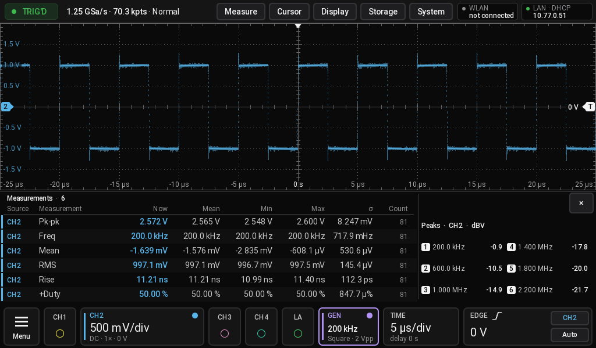 | 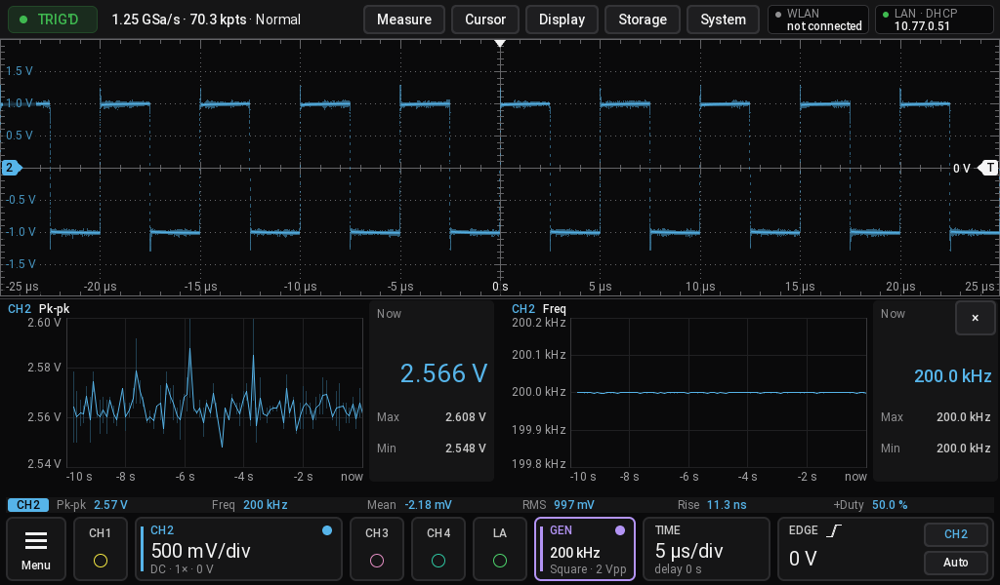 |
| Results pane: every measurement with statistics, peaks beside it | Trend pane: two measurements over time |
| 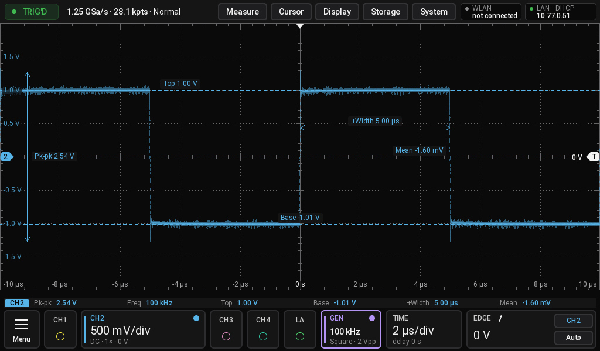 | 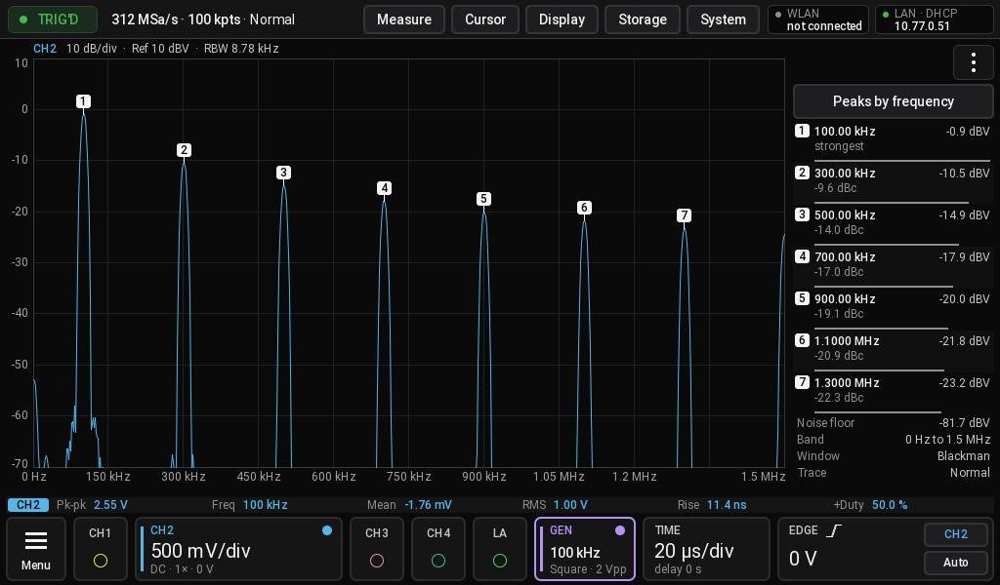 |
| Measurements labelled on the trace | Spectrum view with its peak list |
| 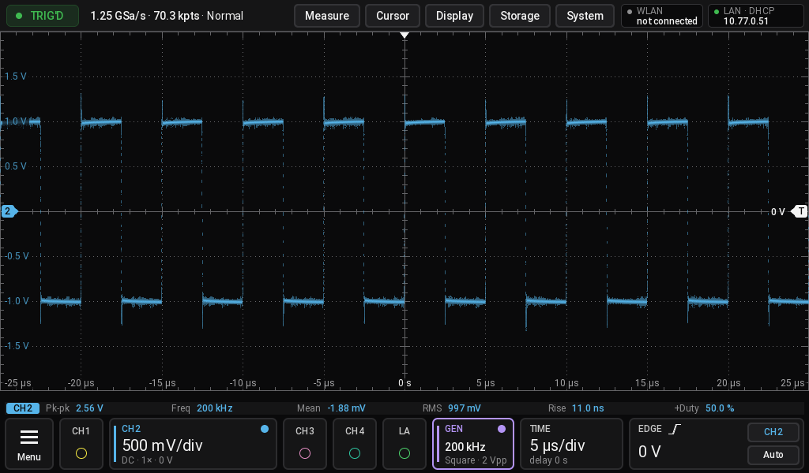 | 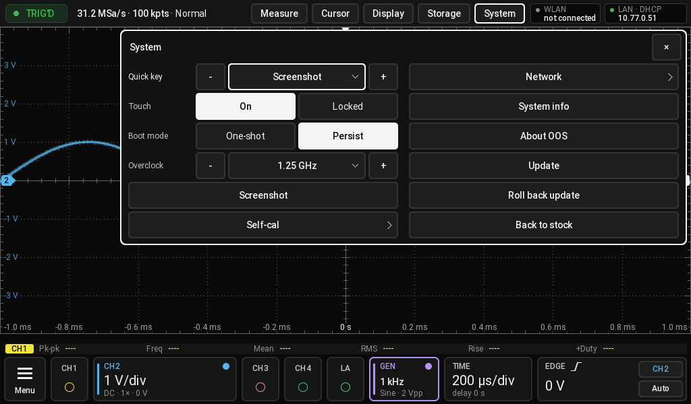 |
| The main screen, 200 kHz from the built-in generator | System menu |
| 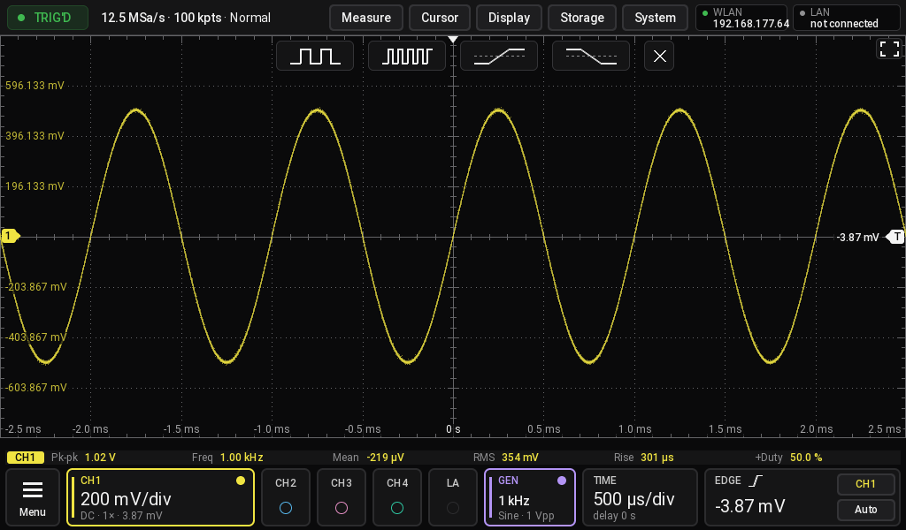 | 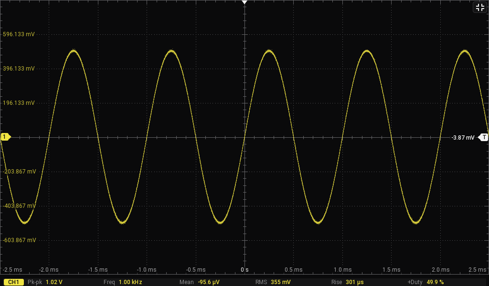 |
| After Auto: a few periods, many periods, rising or falling edge | Full screen, the same button goes back |

## Status

| Area | State |
|---|---|
| Boot, cold boot, acquisition, trigger, roll and scan, touch, front panel, generator (sine, built-in Bode), self-calibration | run on a DHO924S |
| Signed updates from the web page and the shell, kexec trial start, trial and confirmation, install over ADB | run on a DHO924S |
| An update with another device tree, tried by kexec first (kexec-tools, from 0.1.7) | run on a DHO924S: 0.1.6 to 0.1.7 to 0.1.8 through the web page, with cold starts |
| Display > Graphics = GPU, JPEG live picture from the video encoder | run on a DHO924S on the panel; the GPU picture on a monitor (HDMI) not tried yet |
| Frequency counter in the FPGA, backlight, AC/DC by a long press | run on a DHO924S (the counter with the built-in generator, 1.5 Hz to 9.9 MHz) |
| Logic analyser with a PLA2216: lines, pulse widths, edge, pulse, pattern, duration and protocol trigger, UART, SPI and I2C on the lines, roll, scan, whole deep records, CSV | run on a DHO924S, three lines (D0 to D2) driven; thresholds have no effect here, under stock neither |
| Generator modulation (AM, FM, PM), deep memory, limits, web, MCP, VXI-11 | run on a DHO924S |
| HDMI output | run on a DHO924S |
| Automatic rollback of a bad update | tests on the host only |
| USB install without opening the scope | run on a DHO924S with a modified stock system: dry run, first install, run again |
| Generator noise, system info, bandwidth test | tests on the host only |
| Bode with a free-running sweep | tests on the host only (synthetic sweeps); the scan path for sweeps above about 0.9 s is not yet tried on a unit |
| Bode with a generator on USB (USBTMC), UNI-T UTG900 preset | tests on the host only (a simulated USBTMC device); no generator on USB tried yet |
| USB storage stick, 10:1 probe | run on a DHO924S |
| WLAN | driver, firmware and scan run on a DHO924S with an RTL8188EU stick; joining a network tested on simulated radios only |
| Overclocking (System > Overclock) | run on a DHO924S: 1.5 GHz with more noise, 2 GHz with wrong samples; the default stays 1.25 GHz |
| Spectrum, eye and jitter, results and trend panes, measurement labels, Auto | run on a DHO924S with the generator and an RF source |
| Protocol decoders | tested with simulated signals; only some with real signals |
| All models other than the DHO924S | never run |
| Hardware averaging, 800 ps/div | not implemented |

The technical documents in [docs/](docs/README.md) say for each topic whether it is verified on the unit.

Known limits:

- Generator DC level: the output's middle jumps by about 85 mV where the generator switches its range at 2 Vpp.
  Whether the stock system shows the same is not known yet.
- High resolution only gains where the record has more samples than the screen has points.
- Logic analyser: D3 to D15 were not driven with a signal yet.
- WLAN: joining a network has not been tried on the unit.

## Try it without a scope

OOS builds on macOS and Linux and can run scripted without hardware, with its simulated demo signals. It writes a
screenshot in PPM format next to the script:

```sh
cat > /tmp/demo.txt <<'EOF'
frames 30
shot demo.ppm
EOF
cd ui && cargo run -- --script /tmp/demo.txt
```

The commands are listed at the top of [ui/src/cmd.rs](ui/src/cmd.rs). Add `--model DHO804` to act as another model.

To try the web remote with the same demo signals, run this and open `http://localhost:8080/`:

```sh
cd ui && cargo test web_demo -- --ignored --nocapture
```

It runs for 5 minutes.

## Installation

There are three ways:

| Way | Opens the scope | Your original card | State |
|---|---|---|---|
| **Second card**, steps 1 to 8 below | yes | stays untouched in a drawer | run on a DHO924S |
| **[USB stick](#from-a-usb-stick)** | no | OOS goes on it, beside stock | run on a DHO924S with a modified stock system |
| **[ADB over the network](#over-adb)** | no | OOS goes on it, beside stock | run on a DHO924S with a modified stock system |

### From a GitHub release, without building

The [latest release](https://github.com/deckerjulian/oos/releases/latest) has ready-made files. You need no Rust and no
Docker for them:

| File | What it is for |
|---|---|
| `DHO800_DHO900_OOS_Install.GEL` | install from a USB stick through the stock system, without opening the scope: go on at [From a USB stick](#from-a-usb-stick) |
| `oos-<version>.img` | install on a second card: steps 1, 2 and 6 to 8 below, with `--image oos-<version>.img` in step 6. Steps 3 to 5 are the build, skip them |
| `oos-<version>.oosupd` | update a scope that already runs OOS: open `http://<scope>:8080/update` and choose the file, then switch off at the mains, wait 30 seconds and switch on. From 0.1.6 or older, first `oos-0.1.7.oosupd` from the [0.1.7 release](https://github.com/deckerjulian/oos/releases/tag/v0.1.7): later builds bring another device tree, which only 0.1.7 and later can try before they install it |
| `SHA256SUMS` | the checksums of all of them |

Check what you downloaded. The number has to be the same as in the file's line of `SHA256SUMS`:

```sh
shasum -a 256 DHO800_DHO900_OOS_Install.GEL      # macOS
sha256sum DHO800_DHO900_OOS_Install.GEL          # Linux
certutil -hashfile DHO800_DHO900_OOS_Install.GEL SHA256      # Windows
```

ADB needs steps 3 to 5 to build the image.

### On a second card

The steps below use macOS, where they were developed. `tools/sdcard-clone.sh` needs macOS; on Linux, use `dd` for the
clone and `/dev/sdX` instead of `/dev/rdiskN`. That path is untested. Steps 1 and 2 on Windows and Linux, with the
tools to use and what to watch out for: [docs/sdcard-backup.md](docs/sdcard-backup.md).

**You will need for the second card**

- A DHO800/DHO900. The boot SD card is inside, so **you have to open the scope, which voids the warranty**
- A **second SD card**, best of the same size or larger. OOS is only ever installed on this card. A smaller card
  works too (step 2), down to about 8 GB on a stock card.
- A card reader
- Python 3 and this repository (`git clone https://github.com/deckerjulian/oos.git`)
- To build the image yourself, not with a file from a release: [Rust](https://rustup.rs) with
  `rustup target add aarch64-unknown-linux-musl`, and Docker, running. A Rust from the distribution's packages usually
  lacks that target and `rust-lld`. Hosts: macOS on Apple silicon, Linux on arm64 or x86-64. On Linux, run the scripts
  as yourself, not with `sudo`: put yourself in the `docker` group (`sudo usermod -aG docker $USER`, then log in again).
  On x86-64 the kernel is cross-compiled; the image's busybox, wpa_supplicant and e2fsck come from arm64 containers,
  which need QEMU once: `docker run --privileged --rm tonistiigi/binfmt --install arm64`. The workflow
  `.github/workflows/image.yml` builds it all on both Linux hosts. Step by step: [Building on Linux](#building-on-linux).

The whole process takes about an hour, mostly for copying the cards.

### 1. Back up the original card

This step protects your factory calibration. **Do not skip it.**

1. Switch the scope off, unplug the mains cable and all probes, open the instrument and take out the boot SD card.
2. Put the card in the reader and find its disk number:
   ```sh
   tools/sdcard-clone.sh list
   ```
3. Read the whole card into an image. The tool also writes a checksum and a layout report:
   ```sh
   tools/sdcard-clone.sh read diskN ~/oos-backup/sd-original.img
   ```
4. Keep the image in at least two places, then **put the original card away**. From here on you only use the second
   card. On Windows or Linux: [docs/sdcard-backup.md](docs/sdcard-backup.md). Always the whole card, never a
   partition, and never let the computer format or initialise it.

### 2. Write the clone to the second card

```sh
tools/sdcard-clone.sh list
tools/sdcard-clone.sh write ~/oos-backup/sd-original.img diskM    # asks you to type the disk id, then verifies
```

Cards of the same nominal size differ by a few MB. If the second card is smaller than the image, `write` refuses and
names the way out: `fit` makes a copy of the image for that card. The last partition, `userdata` (the stock `/data`,
about 1.4 GB used on a stock card), runs to the end of the card; `fit` checks its ext4 and shrinks it in Docker, as far
as the card needs. The original image is only read.

```sh
tools/sdcard-clone.sh fit ~/oos-backup/sd-original.img diskM ~/oos-backup/sd-fit.img
tools/sdcard-clone.sh write ~/oos-backup/sd-fit.img diskM
```

On Linux, give the card's size in bytes instead of `diskM` (`lsblk -bdno SIZE /dev/sdX`), and write `sd-fit.img` with
`dd`.

Put the second card into the scope, close the instrument and start it once. The stock system must work as before, with
its calibration and licences. Then unplug the scope and take the card out again.

### 3. Build the kernel

Download `linux-6.12.115-base.tar.xz` from the [releases](https://github.com/deckerjulian/oos/releases) into `kernel/src/`
([kernel/README.md](kernel/README.md)), then:

```sh
kernel/build-base.sh        # in Docker, 5-30 minutes depending on the machine, result in kernel/out/base
```

You only have to repeat this when the kernel changes.

### 4. Signing key

Update packages must be signed. To let everyone build updates for every OOS scope, the repository includes a **public
community key**, `keys/community-signing.key`, and all builds trust it. You do not have to do anything: the build uses
it automatically.

The community key only protects against damaged packages. It says nothing about who built one, so **only install
packages from people you trust.**

If you want a scope to accept only your own builds, create your own key before you build:

```sh
cd fpgad && cargo run --release --bin oos-update -- keygen && cd ..
```

Replace all keys in `keys/update.pub` with the line it prints. The secret key is in
`~/.config/oos/update-signing.key`. **Back it up and never publish it.** Details:
[docs/update.md](docs/update.md).

### 5. Build the image

```sh
boot/build-dev-image.sh
```

This produces `boot/out/oos-dev.img` for the card, `boot/out/oos-dev.oosupd`, the signed update package, and
`boot/out/DHO800_DHO900_OOS_Install.GEL` for the USB stick. If the script fails, the previous image stays in place, so
check the file's time.

#### Building on Linux

Steps 3 to 5 on Linux, here with Debian or Ubuntu, on an ordinary x86-64 PC as well as on arm64. On x86-64:

- the kernel and `oos-hw` are cross-compiled with Ubuntu's `gcc-aarch64-linux-gnu` inside the build container; you
  install no cross compiler yourself,
- the Rust programs are cross-compiled by rustup's `aarch64-unknown-linux-musl` target and `rust-lld`,
- busybox, wpa_supplicant and e2fsck come from arm64 containers, which run through QEMU (the `binfmt` line below).
  `docker run --rm --platform linux/arm64 alpine:3.22 uname -m` prints `aarch64` when that works.

Run everything as yourself, not with `sudo`.

```sh
sudo apt install docker.io git python3 curl
sudo usermod -aG docker $USER      # then log out and in again, so that docker runs without sudo
curl --proto '=https' --tlsv1.2 -sSf https://sh.rustup.rs | sh      # Rust from rustup, not from apt
rustup target add aarch64-unknown-linux-musl
# x86-64 only: arm64 containers through QEMU, for busybox, wpa_supplicant and e2fsck (again after a reboot)
docker run --privileged --rm tonistiigi/binfmt --install arm64

git clone https://github.com/deckerjulian/oos.git && cd oos
mkdir -p kernel/src
curl -fL -o kernel/src/linux-6.12.115-base.tar.xz \
  https://github.com/deckerjulian/oos/releases/latest/download/linux-6.12.115-base.tar.xz
kernel/build-base.sh
boot/build-dev-image.sh
```

The scripts say what is missing before they start: Docker not reachable, no rustup or no target, no arm64 containers.
On x86-64 the first build takes longer than on arm64, mostly for wpa_supplicant and e2fsck under QEMU; they are built
once. A finished build leaves the same files as on macOS. The workflow `.github/workflows/image.yml` builds on arm64
and on x86-64 for every release and compares the kernel, the DTB and the files inside the image of the two. To install them on a second card from Linux, see steps 1, 2 and 6,
with `/dev/sdX` for the card.

### 6. Install OOS on the second card

Put the second card in the reader. Unmount it, then do a dry run, which only checks the card and prints the plan. With a
file from a release, write `--image oos-<version>.img` instead:

```sh
diskutil unmountDisk /dev/diskM
sudo python3 boot/card-install.py install /dev/rdiskM --image boot/out/oos-dev.img --fallback-stock
```

The tool refuses cards that do not have the stock layout. If the plan looks right, write it:

```sh
sudo python3 boot/card-install.py install /dev/rdiskM --image boot/out/oos-dev.img --fallback-stock --execute
```

This saves the current `recovery` partition to `backups/`, writes OOS into `recovery`, reads it back, and copies the
stock boot image into the empty `backup` partition. That copy is the fallback if the loader refuses OOS.

Now select OOS for the next start:

```sh
sudo python3 boot/switch.py oos /dev/rdiskM --execute
sudo python3 boot/switch.py show /dev/rdiskM
```

### 7. First start

1. Eject the card, put it into the scope, close the instrument, connect Ethernet and switch on.
2. You see the Rigol logo from the stock loader, then the OOS start-up screen with a checklist.
3. The scope screen appears. Each failed step is named on the screen. A missing calibration file is a warning: the
   scope then runs on defaults and is less accurate.

The IP address comes from DHCP and is shown in the top bar. Without DHCP the scope takes a link-local address
(169.254.x.y, as computers do): a computer connected straight to the scope reaches it without any set-up.

### 8. Choose how OOS starts

By default OOS is **one-shot**: every start of OOS restores the stock boot, so the **next power-on starts the stock
system**. This is the safe mode for a new installation.

To start OOS once more, run this in a telnet session and power-cycle the scope:

```sh
oos-boot-oos-again
```

When OOS works for you, make it the normal system: set **System > Boot mode** to **Persist**, or run
`oos-update mode persist`. It counts from the next power-on. One-shot goes back, and the next power-on starts stock.

Even then, a start that does not complete leaves the stock boot in place, so the next power-on starts the stock system.

### Without opening the scope

Both ways install OOS from the running stock system onto the card that is in the scope. The USB stick takes the update
file of the release or of your build (steps 3 to 5); ADB needs the build.

**Read this before you start**

- **Both ways have run on one DHO924S only, whose stock system is a modified one.** Try them on a card you can take out
  if you can.
- **There is no second card to fall back on.** A refused image is harmless, the loader starts the stock copy. But if the
  kernel hangs before the first script of the image runs, every power-on hangs the same way. The card then has to come
  out, so **the scope has to be opened after all.**
- Only the DHO924S is accepted, the only model OOS has run on. See the [disclaimer](#disclaimer).

The install writes `recovery`, the first 32 MiB of `backup` and, as its very last step, the 4 bytes of `boot` that select
OOS. A failure or power cut before that step leaves a card that starts stock as before, and running the same install
again finishes the job. No stock update step runs, and the FPGA flash and `/rigol` are not touched. Details:
[docs/install-usb.md](docs/install-usb.md).

#### From a USB stick

You need a FAT32 USB stick with at least 200 MiB free, and `DHO800_DHO900_OOS_Install.GEL`: download it from the
[latest release](https://github.com/deckerjulian/oos/releases/latest) and check it against `SHA256SUMS`, or take it from
`boot/out/` of your own build.

1. Copy the file to the top folder of the stick. Keep the name: the scope ignores a file
   whose name does not end in `.GEL` and contain `DHO800_DHO900`.
2. For a dry run, put an empty file `oos-dry-run.txt` next to it. This runs all checks and saves the rescue set, without
   writing the card.
3. Start the stock system, put the stick into the front USB port, open **Storage > Upgrade**, choose the file and start
   it. This takes about a minute. The screen says at the end whether it worked. If Storage does not show the stick,
   switch the scope off and on and look again ([docs/install-usb.md](docs/install-usb.md), section 5). If the list also
   has a small file starting with `._`, that one comes from macOS: choose the real file of about 16 MB.
4. Read `oos-install.log` on the stick on a computer. It should end with `exit code 0`.
5. Delete `oos-dry-run.txt` and run the update again. The log should end with `OOS selected for the next power-on`
   and `exit code 0`.
6. Copy the folder `OOS-rescue` from the stick to a computer and keep it. It holds your calibration (`rigol-data`), the
   stock `recovery` and the start of the card.
7. Switch the scope off at the mains, wait 30 seconds and switch it on. OOS starts.

The scope does not restart by itself after this update. OOS starts once: the power-on after it starts stock again. To stay on
OOS, set **System > Boot mode** to **Persist**. Later versions go in through the `.oosupd` file of a release.

#### Over ADB

You need `adb` on your computer and a scope that answers on its network port 55555 with root access. This is known from a
modified stock system; it has not been checked on an unmodified one.

```sh
adb connect <scope>:55555
adb root
adb connect <scope>:55555        # adb root drops the connection

# your calibration and licences, onto your computer
adb pull /rigol/data rigol-data

# the tool for the scope, not the one in fpgad/target/release
adb push fpgad/target/aarch64-unknown-linux-musl/release/oos-update /data/local/tmp/
adb push boot/out/oos-dev.oosupd /data/local/tmp/
adb shell chmod 755 /data/local/tmp/oos-update

# dry run: all checks, the rescue set, the card is not written
adb shell /data/local/tmp/oos-update gel-install /data/local/tmp/oos-dev.oosupd --save /data/local/tmp/OOS-rescue

# the rescue set onto your computer: keep it
adb pull /data/local/tmp/OOS-rescue

# the install: last line "OOS selected for the next power-on"
adb shell /data/local/tmp/oos-update gel-install /data/local/tmp/oos-dev.oosupd --save /data/local/tmp/OOS-rescue --execute
```

Before the last command, check the rescue set on your computer: run `sha256sum -c SHA256SUMS` in `OOS-rescue`
(`shasum -a 256 -c SHA256SUMS` on macOS). After the install, switch the scope off and on. OOS starts.

The rescue set takes 132 MiB on the scope. Afterwards you can remove it with
`adb shell rm -rf /data/local/tmp/OOS-rescue /data/local/tmp/oos-update /data/local/tmp/oos-dev.oosupd`.

#### After the install

OOS starts once, then the next power-on starts stock again ([step 8](#8-choose-how-oos-starts)). To start OOS once more,
run the same install from the stock system: it writes nothing but the selection. To stay on OOS, use
System > Boot mode > Persist on OOS.

The stock `recovery` is replaced by OOS. Everyday stock use does not need it, but anything that starts into it no longer
works. Putting it back needs the card in a reader, with `recovery.bin` from the rescue set and `boot/card-install.py restore`.

## Daily use

**Controls.** Front-panel keys and knobs work as labelled. The Menu button at the bottom left reaches every function.
A channel key held for more than half a second, or a finger held on a channel's card, switches that channel between
AC and DC coupling.

**Backlight.** Display > Backlight sets the panel's brightness from 10 to 100 %, in steps that look even to the eye. It is
a setting of the scope (`/oos/system.conf`).

**Auto.** Works on the channels that are on, at full bandwidth, and sets the memory depth back to Auto; each channel then
gets its own bandwidth back. With no signal it restores the set-up. Afterwards a bar at the top of the plot offers a few
periods, many periods, the rising edge or the falling edge of the trigger channel; its x or a tap elsewhere closes it.

**Windows and full screen.** Display > Windows splits the plot into two windows side by side, two stacked, or four. The
same page puts each channel, math channel and the LA into a window; a new split spreads the channels that are on. All
windows share the time base, and a drag in a window moves a channel of that window. Zoom, XY and the analysers use one
window. The button with four corners at the top right of the plot gives the plot the whole screen; it shows inward
corners then and brings the top bar and the cards back.

**Text size.** Display > Text size makes the text larger: Normal is the original look, Large and Larger use fonts 2 and 4
pixels bigger in the top bar, the cards, the measurement and cursor rows, the menus, the keyboard and the dialogs. The rows
under the plot grow with them, so the plot gets a little shorter. Where a long text would not fit (a narrow channel card
with four channels on, a long button label in the start menu, a narrow table column) it stays at the next smaller size, and
the dense figure tables of the eye / jitter view keep the normal size. The setting is kept with the other preferences and
across restarts; Default set-up and Recall keep it.

**Bandwidth and noisy signals.** A channel's bandwidth is Auto by default: the limit follows the sample rate, as on the
stock system. With Full, the noise of a slow signal can be larger than the trigger hysteresis and the hardware triggers
on the other edge too; the display still shows the edge you set, and Trigger > Noise reject widens the hysteresis.

**Keyboard.** Names, formulas and WLAN passwords are typed on the on-screen keyboard. The arrows either side of Space
move the insertion point, a tap into the entry puts it there; typing and Delete work at that point.

**Generator.** Tap the frequency in the generator window for a keypad with units; the limits apply by themselves. The - and
+ buttons step it. Changes inside one amplitude range take effect at once and keep the output running.

**Analysers.** Menu > Analysers holds Spectrum, Eye / jitter, Power analysis, Bode and the bandwidth test. They replace the
waveform; the button with three dots at the top right of the plot leads to Exit, Settings and, for the eye, Clear eye.

**Bode with an external generator.** In Analysers > Bode pick the Generator preset (Rigol DG, Siglent SDG, UNI-T
UTG900 for the UTG932 and UTG962, or SCPI for one that takes `FREQ` and `VOLT`), then Connection: LAN with Gen address
(IP, port 5555 if none is given; the knob moves the last number) or USB for a generator in the USB-A port of the scope.
On USB the scope takes the first USBTMC instrument it finds (no PC, no driver), asks it for `*IDN?` and shows the
answer; without one the sweep stops with the reason (no USB device, a device that is not USBTMC, no permission). Rigol
DG and Siglent SDG generators are USBTMC instruments as well. The scope sets channel 1 of the generator to a sine of
Amplitude (Vpp) without offset, switches its output on and steps through the frequencies. Over SCPI,
`:BODE:GENerator "usb"` selects USB and `:BODE:GENerator "192.168.1.20:5025"` the LAN again.
- UNI-T UTG900 commands: `:CHANnel1:MODe CONTINUE`, `:CHANnel1:BASE:WAVe SINe`, `:CHANnel1:AMPLitude:UNIT VPP`,
  `:CHANnel1:BASE:AMPLitude`, `:CHANnel1:BASE:OFFSet 0`, `:CHANnel1:BASE:FREQuency`, `:CHANnel1:OUTPut ON`, from the
  UNI-T UTG900 series programming manual (REV 00, 2022-07-15; the English UTG900E manual has the same commands). Not
  yet tried with a real UTG900.

**Bode with a free-running sweep.** For a generator that the scope does not control, but that sweeps on its own and
gives a sync (marker) pulse at the start of each sweep. Wire the generator to the input of the device under test and to
the input channel (CH1), the output of the device to the output channel (CH2), and the sync output to CH4. In Analysers >
Bode set Generator = Free-running sweep, then the same Start freq, Stop freq, Sweep time and Sweep (Lin or Log) as on the
generator, the Sync channel, its edge and level (the sync pulse must cross the level; set the channel's scale so the
pulse is on the screen). Input (ref) Off compares the output with Ref level in dBV (0 dBV = 1 V RMS) instead of an
input channel. Points is the number of frequencies read from the sweep. Start / stop sweep sets the time base and the
memory for one sweep, triggers once (SINGLE) on the sync edge and waits; start the sweep on the generator. The plot
shows the gain over frequency, the settings come back afterwards.
- Each frequency is read in a short window of the record, about 4 periods long and never wider than 25 % in frequency,
  by a fit of a sine that follows the sweep. Where the sweep passes a frequency in less than one period, that frequency
  is left out (the message says so). Over three decades, 20 Hz needs a sweep time of a few seconds; a linear sweep
  needs much more time for its low end than a logarithmic one.
- Phase comes from the fit of both channels and is shown only with an input channel, where both fits are clean.
- Sweeps up to about 0.9 s run as normal records (100 ms/div at most), the trigger one division from the left edge.
  Longer sweeps run in scan mode (Auto Roll off during the sweep, up to 200 s/div, 500 s and more): the trigger sits
  at the centre, the sweep in the right half, and the record holds min/max pairs. There the gain is half the
  peak-to-peak value in each window, and there is no phase. The start of the sweep is taken from the sync edge in the
  record itself.
- On a 2-channel model use CH1 for the output, CH2 for the sync and Input (ref) Off.
- `:BODE:RUN ON` starts it over SCPI, `:BODE:DATA?` returns the points (phase NaN where there is none).

**Panes.** Display > Pane puts a second view under the waveform: Spectrum with a peak list, Results with statistics, cursors
and peaks, decoder Events, or Trend with two charts. Tap the pane's title for its settings, a trend chart to change its
measurement, the peak list's button to sort it. The x closes the pane.

**Measurements.** A default set-up shows six in the strip above the cards. In Measure > Add item a tap adds a
measurement of the source channel and a second tap removes it. Measure > Labels on trace draws level lines and
arrows with their values on the waveform.

**Overclocking.** System > Overclock sets the sample clock from the next power-on. Above 1.25 GHz the noise rises, and 2 GHz
gives wrong samples: it is for tests only. See [docs/models.md](docs/models.md).

**Web remote.** Open `http://<scope>:8080/`. Click on the picture to touch the screen, drag to swipe. It scales with the
window, so it also works on a phone. The buttons at the bottom save a screenshot or the last record to your computer;
records above 2 million points have to be saved on the scope or read over SCPI. The live picture is a PNG of about 90 KB; "Live picture
format" can switch it to the uncompressed 1.8 MB BMP, or to a JPEG of about 75 KB that the scope's video encoder
makes at under a third of the processor time of a PNG (text a little less sharp; screenshots stay PNG). The choice is kept in the
browser. The PNG is made off the
scope's frame loop, only of a changed screen, up to 20 a second (about 13 reach a browser over Ethernet); the page gets
each new picture as soon as it is made, and while the screen stands still it gets "not modified" instead. The scope's
own screen does not slow down for it. Pause stops the pictures, and a tab in the background stops them too. The Update link leads to the update page.

**Files.** Setups are kept on OOS's own persistent area `/oos` and survive a power cycle. Screenshots and CSV files go to
a USB stick in the front port (FAT32, exFAT or ext4), into the folder `OOS`, and can be pulled whenever nothing is being
saved. Without a stick they go to `/tmp/oos`, which is in RAM and lost at power-off, unless you set another directory
with `--store-dir`. The web remote saves them to your computer too. `/oos` holds 16 MiB for calibration and settings.

**Self-calibration.** System > Self-cal. Let the scope warm up for 30 minutes and disconnect all inputs first. It takes
about 5 minutes per channel and pass, with 4 passes. Results go to `/oos/cal` and are preferred over the factory files,
which are never changed.

**Updates.** Take `oos-<version>.oosupd` from the [latest release](https://github.com/deckerjulian/oos/releases/latest), or
build a package yourself (`boot/out/oos-dev.oosupd`), then install it on the running scope:

```sh
curl --data-binary @oos-<version>.oosupd http://<scope>:8080/update
```

or open `http://<scope>:8080/update` in a browser. The scope restarts into the new build by kexec before anything is
written, and the new build installs itself from there; if its kernel hangs, a power-cycle starts the previous build
again. After the install, power-cycle: that start is the trial (coming from 0.1.0, which has no kexec start, too).
From 0.1.6 or older go to 0.1.7 first: 0.1.8 and later bring another device tree (the GPU and the video encoder on),
and only 0.1.7 and later start such an image by kexec with its own tree; 0.1.6 refuses it.
The new build runs on trial. If it crashes in a loop or never becomes stable, the previous image is written back. System > Update shows the state and
System > Roll back update returns to the previous image. Details: [docs/update.md](docs/update.md).

**Network.** Tap the network box at the top right: it shows the addresses of Ethernet and WLAN and the address of the web
remote. For WLAN, put an RTL8188EU stick into the front USB port, tap Find WLAN networks, tap a network and enter the
password. It joins by itself from then on. Everything open on Ethernet is then open on that network too. Details:
[docs/wlan.md](docs/wlan.md). The page also shows the speed of the Ethernet link; a link at 10 Mbit/s gets one more
autonegotiation (10 Mbit retry, on by default, [docs/network.md](docs/network.md)).

**Date and time.** The scope has no clock battery and starts in 2013. System > Date and time > Time from NTP (off by
default) sets the clock from `pool.ntp.org` or another server whenever a network link comes up, and every hour; Time
zone picks the zone with its daylight saving rules (or takes a POSIX `TZ` string), Set the clock takes it by hand. From
then on file names carry the local date and time (`shot-20261111-143005.png`) instead of a number. The settings are in
`/oos/system.conf`, see [docs/network.md](docs/network.md).

**Waveform files.** Storage saves CSV and a compact binary file `wave-NNN.bin` (`wave-<date>-<time>.bin` once the clock
is set), little endian: `OOSW`, u32 version (1), u32 channels, u64
samples per channel, f64 dt, f64 t0, then per channel its number (u32) and the samples (f32, volts). Both hold the record
on the screen.

**Experimental limits.** `/oos/limits.conf` overrides limits for your own tests. Every applied value is shown at start
and in the System info. See the [disclaimer](#disclaimer) and [docs/models.md](docs/models.md).

## If something goes wrong

Your scope can always be recovered as long as you have the image from step 1: the worst case is writing it to a card
again. Unless noted, the fixes below need the card in the reader, so you have to open the scope again
(`diskutil unmountDisk` first).

| What you see | Meaning | What to do |
|---|---|---|
| The stock system starts instead of OOS | one-shot mode, or the loader refused the OOS image and used the fallback | `boot/switch.py show`, then select OOS again. If that repeats, rebuild the image. |
| Rigol logo stays, nothing else, on every start | the kernel hangs before OOS runs | `sudo python3 boot/switch.py stock /dev/rdiskM --execute`, then install a working image |
| Black screen; a Rockchip USB device (2207:330c) appears | the loader refused `recovery` and has no fallback | `switch.py stock`. If needed, `sudo python3 boot/card-install.py restore /dev/rdiskM --backup backups/recovery-<date>.bin --execute` |
| Start-up screen stops at a step | a hardware step failed | Read the stage on the screen. Logs are at `/tmp/oos-boot.status` and `/tmp/oos-cold.log` over telnet. |
| A new build misbehaves | | System > Roll back update, or `oos-update rollback --execute` |
| Nothing helps | | Write `sd-original.img` to the second card again (step 2) |

Serial console: UART2, 115200 8N1. The stock loader also reports there why it refuses an image.

## Going back to stock

- In one-shot mode: power-cycle. System > Back to stock says the same.
- In persist mode: System > Boot mode > One-shot, then power-cycle. Or, with the card in the reader:
  `sudo python3 boot/switch.py stock /dev/rdiskM --execute`
- For good: put your original card back. After an install without opening the scope, see
  [After the install](#after-the-install).

OOS never writes the FPGA flash, `/rigol/data`, or the `uboot`, `trust` and `parameter` partitions.

## Repository layout

| Path | Content |
|---|---|
| `hal/` | Hardware layer: FPGA register sequences, front ends, ADC, PLL, cold boot, models, updates |
| `dsp/` | Signal processing: triggers, measurements, maths, decoders, analysers |
| `ui/` | `oos-ui`: scope screen, SCPI, VXI-11, web remote |
| `fpgad/` | `oos-fpgad` bring-up tool and `oos-update` |
| `boot/` | Boot image packer, image build, card installer, USB installer, stock/OOS switch |
| `rootfs/initramfs/` | Init scripts and firmware of the image |
| `rootfs/build-wlan-tools.sh`, `rootfs/build-fsck.sh` | Build wpa_supplicant and e2fsck in Docker |
| `keys/` | Public keys trusted for updates, community signing key |
| `tools/` | Card cloning and analysis, device inventory, Python models ([README](tools/README.md)) |
| `kernel/` | Kernel source, own patches, device tree, configuration, build in Docker, licences ([README](kernel/README.md)) |
| `CHANGELOG.md` | What changed between releases |
| `docs/` | Technical documentation: architecture, boot, hardware, register-level protocols ([index](docs/README.md)) |

## Development

Each crate builds on its own. The hardware code is Linux-only, so check it for the target as well:

```sh
(cd hal && cargo test)
(cd dsp && cargo test)
(cd ui && cargo test)
(cd fpgad && cargo test)
(cd ui && cargo check --target aarch64-unknown-linux-musl)
```

Tests that need the calibration files of a real unit are skipped without them. To run them, copy `/rigol/data` of your
scope to `local/cal-full` and `local/cal` (the folder `local/` stays out of git). `OOS_CAL_DIR` overrides this for most of
them.

`tools/plan-matrix.sh` prints the register sequences of a fixed set of acquisitions without touching the hardware. Run
it with two builds and compare the output to prove that a change leaves the analog path alone.

The test `every_menu_fits` walks all menus and fails on text wider than its control or a dialog off the screen.
`OOS_GALLERY=<dir> cargo test gallery -- --ignored` in `ui/` writes every screen as a picture.

`tools/gel-sim.sh` runs the USB install on a file laid out like a stock card.

`tools/usb-sim.sh` tests the handling of USB sticks in a virtual machine, with disks that get pulled.

`tools/wlan-sim.sh` tests the WLAN path on simulated radios in a virtual machine, without a stick. It needs Docker,
`qemu-system-aarch64` and one finished image build.

Start with the [hardware overview](https://deckerjulian.github.io/oos/hardware/overview.html) and [docs/architecture.md](docs/architecture.md).

## Licences

OOS is free software under the GNU General Public License, version 2 or (at your option) any later version. See
[LICENSE](LICENSE).

Third-party parts keep their own licences:

| Part | Licence |
|---|---|
| Linux kernel and patches | GPL-2.0, device trees GPL-2.0+ OR MIT; see [kernel/README.md](kernel/README.md) |
| XDMA driver | Dual BSD/GPL |
| BusyBox | GPL-2.0 |
| e2fsck (e2fsprogs) | GPL-2.0; the notice is in the image at `/etc/licenses/e2fsck` |
| kexec (kexec-tools) | GPL-2.0; the text is in the image at `/etc/licenses/kexec-tools` |
| Mesa, libdrm, glibc, libstdc++, zlib (the GPU helper, [gpu/README.md](gpu/README.md)) | MIT, MIT, LGPL-2.1, GPL-3.0 with the runtime exception, zlib; the texts are in the image under `/etc/licenses` |
| Roboto font | Apache-2.0, see [ui/tools/fonts/LICENSE-Roboto.txt](ui/tools/fonts/LICENSE-Roboto.txt) |
| wpa_supplicant | BSD-3-Clause; the text is in the image at `/etc/licenses/wpa_supplicant` |
| RTL8188EU firmware | Realtek's redistribution licence, see [LICENCE.rtlwifi_firmware.txt](rootfs/initramfs/lib/firmware/rtlwifi/LICENCE.rtlwifi_firmware.txt) |

If you pass on an OOS image, the GPL requires you to provide the corresponding source, including the kernel source.
