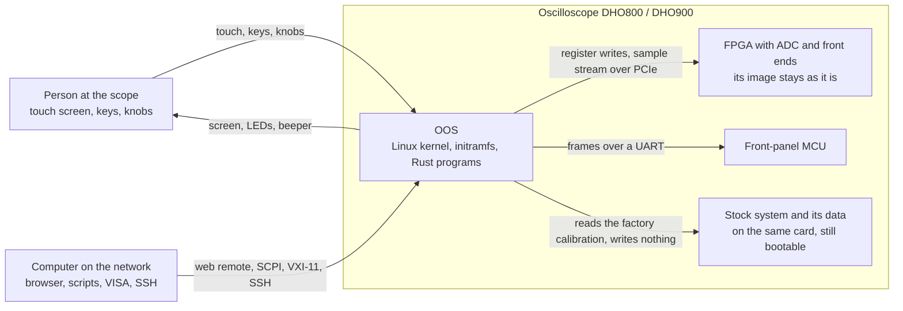
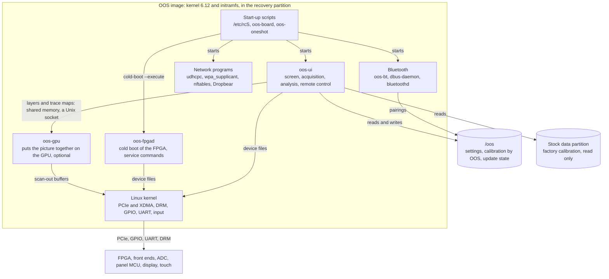
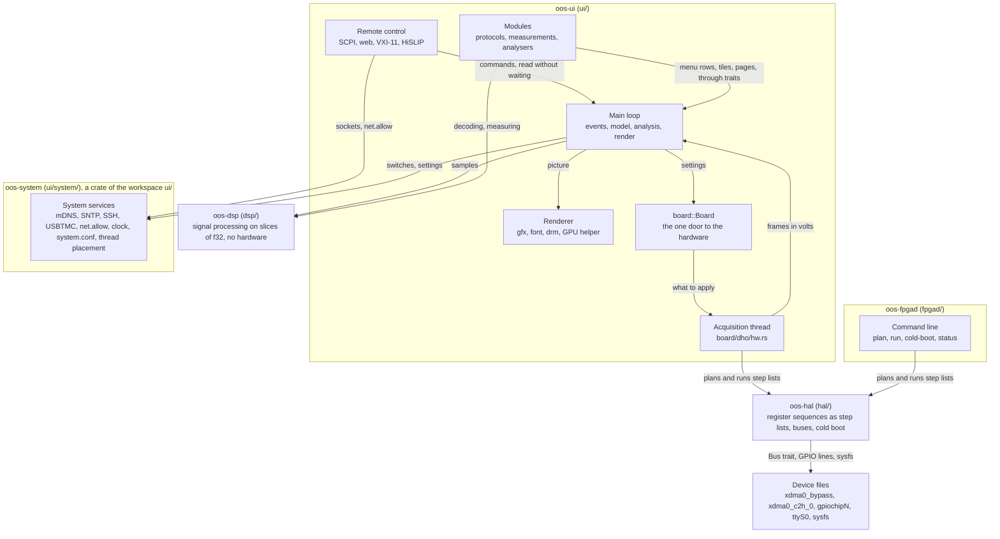
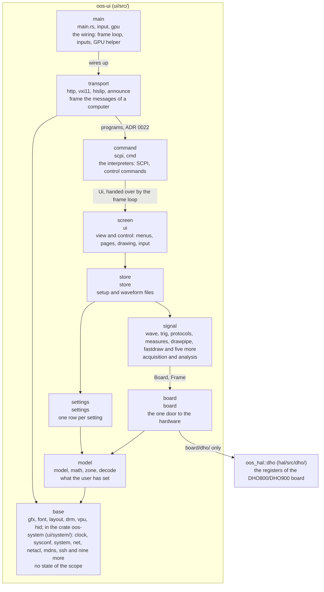

# OOS architecture

How the pieces of OOS fit together: from the SD card over the kernel to the Rust crates and the GUI. The register-level
details are in `protocols/`.

The diagrams follow the C4 levels: the scope and who uses it, the programs of the image, the parts inside the
programs, and the layers inside `oos-ui`. They are drawn from the code; the files are named under each.

## The scope and who uses it



Drawn from: [boot.md](boot.md), [network.md](network.md), ADR 0009 and ADR 0011, `ui/src/main.rs`.

What a computer may build on is the remote interface: the SCPI commands, the HTTP routes and the MCP tools, each
marked stable or experimental in its reference and versioned as a whole
([ADR 0055](adr/code/0055-the-remote-interface-is-stable-and-versioned.md)). Add-ons use the same interface from a
process of their own on the scope, not code inside `oos-ui`
([ADR 0056](adr/code/0056-add-ons-run-outside-the-core-and-use-a-stable-extension-interface.md)); both are accepted.

## The programs of the image



Drawn from: `rootfs/initramfs/etc/rcS`, `rootfs/initramfs/bin/`, `ui/src/main.rs`, `ui/src/gpu.rs`, `fpgad/src/main.rs`,
`hal/src/dho/calfile.rs`, [boot.md](boot.md).

## Boot and system

```
SD card (stock layout, boot.md)
 ├─ boot       stock Android kernel; magic "KRNL" -> stock boots, "OOSK" -> the loader falls back to recovery
 ├─ recovery   OOS image (kernel 6.12 + DTB + initramfs), built by boot/build-dev-image.sh
 ├─ backup     copy of the stock boot image (fallback), rollback slot, /oos data partition (update.md)
 └─ rigol      stock data incl. /rigol/data/cal_*.hex; OOS mounts it read only (oos-mount-rigol)

initramfs /etc/rcS:  oos-oneshot (KRNL back, next power-on = stock) + start count -> oos-board early (FPGA BOOT command) ->
                     network in the background -> SSH (when on: password or key) -> oos-board drivers (touch edt-ft5x06, beeper pwm-gpio) ->
                     oos-ui (start-up screen) -> in the background oos-mount-stock (read only) +
                     oos-board bring-up (oos-fpgad cold-boot --execute --power-on) (order and status: boot.md)
FPGA:                cold boot by OOS (default); the warm hand-over from the stock system still works
```

Kernel: a 6.12 GPL kernel rebuilt in Docker (`kernel/`; sources and licences in `kernel/README.md`), with the DHO900 DTS (fan hog, pwm-gpio beeper,
AFE/PLL GPIO line names). PCIe host and XDMA are modules, loaded only when the FPGA is up.

## Rust crates



Drawn from: `ui/src/main.rs`, `ui/system/src/lib.rs`, `ui/src/board/mod.rs`, `ui/src/board/dho/hw.rs`, `ui/src/protocols/mod.rs`,
`ui/src/measures/mod.rs`, `fpgad/src/main.rs`, `hal/src/dho/`. `oos-ui` also offers the control FIFO
`/tmp/oos-ui.ctl`, and takes its signal from one of four sources: Demo, Replay, Live or Hw (below).

Rule for all crates: no vendor code is in the tree. Only dependency of the four crates: `libc` (ADR 0013,
[fork/deps.md](fork/deps.md)). `ui/` is a Cargo workspace: a layer of `oos-ui` that names nothing above it leaves it
as a crate of its own below `ui/`, with one lock file and one target folder for all of them
([ADR 0064](adr/code/0064-a-layer-of-oos-ui-without-crossings-becomes-a-crate-of-its-own.md)). The first is
`oos-system` (`ui/system/`): the system services, on `libc` and `oos-hal`. `oos-ui` brings its modules into its crate
root (`main.rs`), so they are named `crate::sysconf` there as before, and the compiler refuses a path from
`oos-system` back into `oos-ui`.

### oos-hal: hardware layer

Pure functions build lists of `(offset, value)` writes and update software shadows of write-only registers, so the
host tests check them against fixtures from the Python models (`tools/*model.py`) and the device logs. Applying a list
is a separate step through `dho::bus::Bus` (`Bar1` on the unit, `Recorder` in tests).

The crate root holds what does not depend on the board: `model`, `update`, `wlan`, `dbus`, `bluez`, `bootstatus`,
`vendorkeys`. Everything of the DHO800/DHO900 board is in `oos_hal::dho` (`hal/src/dho/`); a port to another board
family adds a module next to it ([porting.md](porting.md)).

| Module (in `dho` unless noted) | Role |
|---|---|
| `bus`, `gpio` | BAR1 access (mmap of /dev/xdma0_bypass), GPIO character device by DT line name |
| `scu`, `spu`, `hz`, `acq`, `tpu`, `wpu` | FPGA blocks: run/stop/arm/read-out, sample rate, time base, acquisition configuration, trigger unit (12 types), read-path gain |
| `afe`, `adc` | RT1642 front ends (bit-banged SPI, efuse trim, V/div, offset, bandwidth), ADC modes and calibration |
| `seq` | settings -> complete step list (ADC mode, AFE, trigger, acquire, arm, read-out) with a persistent shadow state; execution and channel de-interleaving |
| `boot` | cold boot steps 1-21 (FPGA boot command, PLL, AFE, ADC, SPU/SCU, checks, calibrations) against a `Hw` bundle, plus a unit model for dry runs |
| `panel` | front-panel MCU frames: LEDs, power commands |
| `board` | XADC (FPGA temperature, VCCINT), thermal zones, over-temperature guard, beeper |
| `afg` | built-in generator (`protocols/afg.md`) |
| `clock` | ADC clock domain (`models.md`) |
| `model` (root) | model identity, capabilities and limits (`models.md`) |
| `update` (root) | signed updates with rollback (`update.md`) |
| `wlan` (root) | control socket of wpa_supplicant, its answers, key derivation (`wlan.md`) |
| `dbus` (root) | a D-Bus client of its own: the wire format, SASL EXTERNAL, calls and the calls that come in |
| `bluez` (root) | bluetoothd's objects and calls for mice and keyboards, the pairing agent |

### oos-dsp: signal processing

Platform independent, no hardware. Software trigger for all 12 types, 35 measurements, math and FFT, the protocol
decoders as modules (`protocols`: key, name, lines, the call of the decoder, bit time and protocol trigger rule of
each), mask test, signal generators for tests and the demo source. Waveforms are `&[f32]` volts with a fixed `dt`.

### oos-ui: the scope screen

One process, software renderer on DRM dumb buffers (`drm`, `gfx`, `font`), layout in `ui`, state in `model`.

Protocol decoders that come as modules (`ui/src/protocols`, [protocol-modules.md](protocol-modules.md)) bring their
menu rows, labels, demo traffic and an optional view of their own through one trait, `Protocol`; what each one is,
the call of its decoder, its timing and its protocol trigger rule come from its `ModuleInfo` in `oos-dsp`.
Measurements come the same way (`ui/src/measures`, [measurement-modules.md](measurement-modules.md)): a
`MeasModule` gives its tiles on the measurement page and computes its values on the catalog worker thread.
Analyser pages implement `Analyser` (`ui/src/ui/analysers.rs`, [analyser-modules.md](analyser-modules.md)): the start
menu, System > Features, the view bar, SCPI `:VIEW`, setups, the record and the drawing ask that registry.

Everything the UI asks of the hardware goes through the trait `board::Board` (`ui/src/board/mod.rs`): what the
acquisition thread is to apply, the generator, the front-end steps, the front panel, the board readings. The UI speaks
in the model's terms and gets frames in volts back (`board::Frame`, `board::to_record`). `board::dho` implements it
for the DHO800/DHO900 and is the only part of the UI that uses `oos_hal::dho`; a lint test
(`board::boundary`) keeps it that way. The board is chosen when OOS is built (`board::Active`).

Threads:

| Thread | Job |
|---|---|
| main | input events -> model, acquisition step of the active source, analysis (dsp), render, page flip; reads the web, SCPI and VXI-11 connections without waiting (`net::read_now`): nothing in the loop may block on the network |
| input | front-panel UART (keys, knobs, LED frames), touch, and USB or Bluetooth mice and keyboards (evdev, taken for oos-ui alone; `hid.rs` says what an event means, `ui/src/ui/pointer.rs` acts on it) |
| hw (`--hw`) | the board's acquisition thread (`Board::spawn`; on the DHO800/DHO900 `board/dho/hw.rs`: `hal::dho::seq` plan/execute in a loop); hands frames over through `board::HwShared` |
| live (`--fpga-live`) | experimental, DHO800/DHO900: repeats the verified read-out (no arming) |
| scpi, http, hislip, announce | SCPI on 5555, web remote on 8080 (polled by the main thread), HiSLIP on 4880 (a computer), mDNS announcement on 5353 |
| web-png, web-send | the web remote's PNG of the screen (made only of a changed screen, at most 20 a second and half a core) and the large answers; SCHED_IDLE on the slow cores (A53), so the frame loop and the acquisition never wait for them |
| control FIFO | `/tmp/oos-ui.ctl` text commands (`cmd`), used by remote tests |
| bt | System > Network > Bluetooth's client of bluetoothd (`ui/src/ui/bt.rs` over `hal::bluez`): the state every 2 s, scan, pair, connect, forget, and the pairing agent's answers; started with the first look at the page, so the frame loop never waits on the radio |
| ntp | SNTP exchange and clock step when Time from NTP is on (`ui/system/src/sntp.rs`, the page in `ui/src/ui/time.rs`; `network.md`) |

Sources (`wave::Source`): `Demo` (dsp generators, triggers checked by the software trigger), `Replay` (a saved frame),
`Live` (read-out loop), `Hw` (real acquisitions of the board; on the DHO800/DHO900 the TPU trigger is set to the
selected type, the software trigger finds the point again in the data). Only `Demo` gives a trigger type starting
values when it is chosen, values that trigger on its signals; with every other source a new type keeps what the user
set (width, pattern, levels), and the lower level of Slope, Runt and Window stays at or below the upper one.

### Layers inside oos-ui

Every module of `oos-ui` is in one layer, and a layer names only the layers below it that its row allows
([ADR 0049](adr/code/0049-the-layers-inside-oos-ui.md), which has the table with every module). An arrow reads "may
name" and carries on down the arrows, with two limits: a transport names only the interpreters and base, and the
store does not name the board.



Drawn from: `tools/layers.py` (`UI_LAYERS`, which places every module and is what `tools/layers.py --list` checks
the paths against), `ui/src/main.rs` (the modules and the frame loop), `ui/src/board/mod.rs`. The code does not hold
the arrows everywhere yet: the paths against them are counted in `tools/layers.txt` and may only become fewer
(ADR 0037, ADR 0049). A new module gets its row in `UI_LAYERS` before the checks pass. The part of base in
`oos-system` is held by the compiler instead: it is a crate of its own and cannot name `oos-ui` (ADR 0064).

### oos-fpgad: bring-up and service tool

A thin CLI over `hal`: prints any plan without hardware (`plan`, dry runs everywhere), runs it only with `--execute`,
checks the FPGA version before writing, refuses 0x1008 and the excluded FPGA slot. Board commands (`temp`, `beep`,
`guard`). Meant to become the daemon that owns the FPGA once oos-ui and SCPI share one acquisition engine.

## Where a change goes

Each kind of change has its place. The first seven are the kinds of extension: each has one place where it is
declared, a recipe in [CONTRIBUTING.md](../CONTRIBUTING.md#adding-something) and a test that names what is missing
([ADR 0046](adr/process/0046-every-kind-of-extension-has-a-recipe-and-a-check.md)).

| A change of | Goes into | Kept complete by |
|---|---|---|
| a setting | a row of its group's table in `ui/src/settings/`; the setup file, SCPI, the menu row and the docs table follow | `ui/src/settings/tests.rs::every_row_is_complete` |
| a measurement | a measurement module in `ui/src/measures/`, its numbers in `dsp/src/` | `ui/src/measures/mod.rs::every_measurement_is_complete` |
| a protocol decoder | the decoder and its `ModuleInfo` in its family file of `dsp/src/decode/` (C-PHY in `dsp/src/cphy.rs`, the line codes in `dsp/src/linecode.rs`), a protocol module in `ui/src/protocols/` | `ui/src/protocols/mod.rs::every_decoder_is_complete` |
| a trigger type | `ui/src/model/trigger.rs`, the software trigger in `dsp/src/trigger.rs`, the hardware trigger in `hal/src/dho/tpu.rs` | `ui/src/model/trigger.rs::every_trigger_type_is_complete` |
| an analyser page | its file in `ui/src/ui/`, registered in `ui/src/ui/analysers.rs` | `ui/src/ui/analysers.rs::every_page_is_complete` |
| a remote command | the interpreter, `ui/src/scpi.rs` and its subsystem's file in `ui/src/scpi/`; never a transport | `tools/scpi-coverage.py` |
| a register sequence, a hardware fact | first `docs/protocols/`, then the block's module in `hal/src/dho/` | `hal/tests/register_modules.rs::every_module_names_its_page_and_has_a_test`, `tools/compare-base.sh` |
| a menu, a row, a dialog | `ui/src/ui/`: `item.rs` (the items and their parts), `menu_items.rs`, `menu_text.rs`, `menu_actions.rs`, `menu_dialog.rs` | `ui/src/ui/lint/menu_layout.rs::every_menu_fits`, `ui/src/ui/item.rs::no_menu_item_has_two_parts` |
| the state of the scope, a default | `ui/src/model.rs` and `ui/src/model/` | the tests of `ui/src/model.rs` |
| what a setup or a file stores | `ui/src/store.rs` and `ui/src/store/` | `ui/src/store/settings_snapshot.rs` with `ui/tests/golden/settings.txt` |
| signal processing | `dsp/src/`, on slices of `f32`, no hardware | the tests in `dsp/tests/`, `tools/layers.py` |
| what the UI asks of the hardware | the trait `Board` in `ui/src/board/mod.rs`, for this board `ui/src/board/dho/` | `tools/layers.py` |
| a remote transport | its file in `ui/src/` (`http.rs`, `vxi11.rs`, `hislip.rs`); a transport only frames messages for the interpreter (ADR 0022) | the tests in its file; its switch under Remote services (ADR 0025) |
| a network or system service (mDNS, SNTP, SSH, `net.allow`, the clock, `system.conf`) | its module in `ui/system/src/`, the crate `oos-system`, which names nothing of `oos-ui` (ADR 0064) | the tests in its file, `cargo test --workspace` in `ui/`; its switch under Remote services (ADR 0025) |
| the start, the image, an update | `boot/`, `kernel/`, `rootfs/`, `hal/src/update/` | the simulations of `tools/check.sh` (`sim`), a run on a unit |
| a host tool, a check | `tools/`, with its line in `tools/README.md` | `tools/tests/`, the layers of `tools/check.sh` |
| a decision others build on | a record in `docs/adr/` and its row in `docs/adr/README.md` | the pull request (ADR 0031) |

The texts a change brings along are listed in [AGENTS.md](../AGENTS.md#keeping-the-texts-true).

## Data path of one acquisition (`hal::dho::seq`)

```
Settings (model) ── plan ──> steps: ADC mode words (0x1034) -> AFE (GPIO SPI) -> read-path gain (WPU) ->
                             trigger (TPU) -> acquisition configuration (SPU/SCU) -> auto trigger -> arm ->
                             wait 0x4080 bit30 -> read-out (play window, TX size) -> c2h read
c2h bytes ── deinterleave ──> per-channel u16 codes ── volts (scale, offset, cal) ──> f32 -> dsp -> screen
```

## Tests

| Crate | Host tests | What they pin down |
|---|---|---|
| hal | `cargo test` in hal/ | write sequences against fixtures and device logs, cold boot against the unit model, panel CRCs, board logic |
| dsp | `cargo test` in dsp/ | every trigger, measurement, decoder and math function against signals with known answers |
| ui | `cargo test` in ui/ | menus, rendering (screenshots), every trigger type triggers on the demo, storage |
| fpgad | `cargo test` in fpgad/ | option parsing, status interpretation |

Every parser of outside input (files, the network, remote commands, the samples of a record) also has a hostile-input
test: `cargo test hostile` in hal/, dsp/ and ui/ feeds it mutated valid inputs from a fixed seed, and it must return,
not panic, and accept only what its contract allows; `OOS_HOSTILE_ITERS` raises the number of inputs
([ADR 0047](adr/process/0047-parsers-of-outside-input-have-hostile-input-tests.md)).

Builds for the unit: `--target aarch64-unknown-linux-musl` (static, rust-lld).

## Lessons from the first device tests

- Read-out after an own arm needs the play-side chain in pass-through (`scu::passthrough`), else the live compression
  starves the TX and the c2h read times out (`protocols/record-play.md`).
- The read-path gain/offset (WPU) must be OOS's own: values left by the stock system shift the codes.
- 0x1210 counts the ADC data clock, which runs only after the ADC sync and eye scan: check it after step 12.
- UI state: settings survive oos-ui restarts within a boot (`/tmp/oos-ui.setup`); the settings of the scope itself
  (NTP, time zone, Ethernet) are in `/oos/system.conf` (`sysconf`, `network.md`), apart from the setups; the power key
  talks to the panel MCU (`FA 05 02`, dialog, `FA 05 01/03`; `protocols/board.md` 4).
